# Design Document: Predictive Maintenance Sensor Firmware

## Overview

This design describes the firmware architecture for a predictive maintenance sensor running on the M5StickC Plus 2 (ESP32-PICO-V3-02). The firmware reads vibration and temperature data from the onboard MPU6886 IMU, normalizes it adaptively, feeds it through a sliding temporal window into an online autoencoder (trained via Sanger's Rule), and classifies each duty cycle as normal or anomalous. The system operates on a strict deep-sleep duty cycle to conserve the 200mAh battery, persists learned state across sleep in RTC memory (with CRC-16 validation), periodically snapshots to NVS flash, and connects to Wi-Fi only for anomaly alerts or 12-hour heartbeats.

All runtime memory is statically allocated. The total RTC memory budget is 8KB. No heap allocation occurs during the duty cycle.

### Key Design Decisions

1. **Single-file firmware with modular C++ namespaces** — Avoids the overhead of a multi-library Arduino build while keeping logical separation. Each subsystem (IMU, Normalizer, Window, ML, RTC, NVS, Connectivity) is a namespace with its own static state.
2. **Sanger's Rule over backpropagation** — Sanger's Rule (Generalized Hebbian Algorithm) is an online, unsupervised learning rule that requires no labeled data and has O(n²) memory for an n-dimensional weight matrix. It is well-suited to the constrained ESP32 environment.
3. **Circular buffer in RTC memory** — The sliding window is a fixed-size circular buffer stored in RTC slow memory, surviving deep sleep without flash writes.
4. **CRC-16 for RTC validation** — A lightweight checksum that fits in 2 bytes and catches bit-rot or incomplete writes after deep sleep.
5. **Event-driven Wi-Fi** — Wi-Fi is only initialized when needed (anomaly or heartbeat), keeping the radio off during sampling and inference to save power and reduce wake time.

## Architecture

```mermaid
graph TD
    subgraph Duty Cycle
        A[Wake from Deep Sleep] --> B[Validate RTC Memory CRC-16]
        B -->|Valid| C[Restore State from RTC]
        B -->|Invalid| D[Hard Boot: Restore from NVS]
        D -->|NVS Valid| C
        D -->|NVS Invalid| E[Initialize Fresh State]
        E --> C
        C --> F[Initialize MPU6886 IMU]
        F -->|Fail| G[Log Failure → Deep Sleep]
        F -->|OK| H[Sample 500 readings at 100Hz]
        H --> I[Compute Vibration_Magnitude & Temperature_Delta]
        I --> J[Adaptive Normalizer: Update or Freeze]
        J --> K[Append Batch Summary to Sliding Window]
        K --> L[ML Engine: Encode → Decode → Reconstruction Error]
        L --> M{Reconstruction Error > Threshold?}
        M -->|Yes: Anomaly| N[Skip Weight Update, Freeze Normalizer]
        M -->|No: Normal| O[Sanger Rule Weight Update]
        N --> P{Wi-Fi Needed?}
        O --> P
        P -->|Anomaly Alert| Q[Connect Wi-Fi → HTTP POST Alert]
        P -->|Heartbeat Due| R[Connect Wi-Fi → HTTP POST Heartbeat]
        P -->|No| S[Check NVS Save Conditions]
        Q --> S
        R --> S
        S --> T[Save State to RTC Memory + CRC-16]
        T --> U[Deep Sleep]
    end
```



### Execution Timeline (per Duty Cycle)

| Phase                      | Duration Budget | Description                 |
| -------------------------- | --------------- | --------------------------- |
| Wake + RTC Validate        | ~50ms           | CRC check, state restore    |
| IMU Init                   | ≤500ms          | MPU6886 power-on and config |
| Sampling                   | 5000ms          | 500 samples at 100Hz        |
| Normalize + Window + Infer | ~500ms          | Compute-bound, no I/O       |
| Connectivity (if needed)   | ≤15s            | Wi-Fi connect + HTTP POST   |
| RTC Save + Sleep Entry     | ~50ms           | CRC write, enter deep sleep |

Total sampling+inference budget: ≤8 seconds (per Requirement 5.4).

## Components and Interfaces

### 1. IMU Module (`imu::`)

**Responsibility:** Initialize MPU6886, collect 500 samples at 100Hz, compute per-sample Vibration_Magnitude and read temperature.

```cpp
namespace imu {
    bool init();                          // Returns false if MPU6886 not responding
    void sample(float vib_out[500], float temp_out[500]); // Fills arrays
}
```

- Uses `M5.Imu.Init()` internally.
- Reads accelerometer registers via I2C at 100Hz using `delayMicroseconds` timing.
- Computes `sqrt(ax² + ay² + az²)` per sample.
- Temperature read once per sample from the IMU temperature register.

### 2. Adaptive Normalizer (`normalizer::`)

**Responsibility:** Maintain running mean/variance for vibration and temperature, normalize batches, freeze on anomaly.

```cpp
namespace normalizer {
    struct Stats {
        float mean_vib;
        float var_vib;
        float mean_temp;
        float var_temp;
    };

    void update(const float vib[500], const float temp[500], Stats& stats, float alpha);
    void normalize(const float vib[500], const float temp[500],
                   const Stats& stats,
                   float norm_vib[500], float norm_temp[500]);
    void freeze();  // Skip update for this cycle
}
```

- EMA update: `mean_new = (1 - α) * mean_old + α * batch_mean`
- Variance EMA: `var_new = (1 - α) * var_old + α * batch_var`
- Normalization: `x_norm = (x - mean) / sqrt(var + ε)` where ε = 1e-6
- `Stats` struct stored in RTC memory.

### 3. Sliding Window (`window::`)

**Responsibility:** Circular buffer of batch summaries (mean vibration, mean temperature per cycle).

```cpp
namespace window {
    static const int WINDOW_SIZE = 16;  // 16 duty cycles of context

    struct Entry {
        float mean_vib;
        float mean_temp;
    };

    struct WindowState {
        Entry buffer[WINDOW_SIZE];
        int head;
        int count;
    };

    void append(WindowState& state, float mean_vib, float mean_temp);
    void to_flat_array(const WindowState& state, float out[WINDOW_SIZE * 2]);
}
```

- `append` overwrites oldest entry when full (circular).
- `to_flat_array` produces the ML input vector in temporal order: `[vib_0, temp_0, vib_1, temp_1, ...]`.
- `WindowState` stored in RTC memory.

### 4. ML Engine (`ml::`)

**Responsibility:** Autoencoder inference, Sanger's Rule weight update, reconstruction error computation.

```cpp
namespace ml {
    static const int INPUT_DIM = 32;    // WINDOW_SIZE * 2
    static const int LATENT_DIM = 4;    // Compression ratio 8:1

    struct Weights {
        float encoder[LATENT_DIM][INPUT_DIM];   // 4 x 32 = 128 floats
        float decoder[INPUT_DIM][LATENT_DIM];   // 32 x 4 = 128 floats
        float learning_rate;
        int normal_cycle_count;
        int anomaly_streak;
    };

    struct InferenceResult {
        float reconstruction_error;
        bool is_anomaly;
        float latent[LATENT_DIM];
    };

    InferenceResult infer(const float input[INPUT_DIM], const Weights& w, float threshold);
    void update_weights(const float input[INPUT_DIM], const InferenceResult& result, Weights& w);
    void init_weights_random(Weights& w);
    float compute_weight_shift(const Weights& current, const Weights& saved);
}
```

- **Encoder:** `latent[j] = Σ_i encoder[j][i] * input[i]`
- **Decoder:** `reconstructed[i] = Σ_j decoder[i][j] * latent[j]`
- **Reconstruction Error:** `MSE = (1/INPUT_DIM) * Σ_i (input[i] - reconstructed[i])²`
- **Sanger's Rule Update (encoder):**
  ```
  Δw_ji = η * (latent[j] * input[i] - Σ_{k≤j} latent[k] * w_ki * latent[j])
  ```
- **Decoder update:** Transpose of encoder update (tied weights approach).
- **Learning rate decay:** `lr = lr_initial / (1 + decay_rate * normal_cycle_count)`
- **Learning rate reset:** After `N` consecutive anomalous cycles, reset `lr` to `lr_initial`.
- Weight skip on anomaly: `update_weights` is not called when `is_anomaly == true`.

### 5. RTC Memory Manager (`rtc::`)

**Responsibility:** Pack/unpack all persistent state into RTC slow memory with CRC-16 validation.

```cpp
namespace rtc {
    struct RtcBlock {
        normalizer::Stats norm_stats;
        window::WindowState window_state;
        ml::Weights ml_weights;
        uint32_t duty_cycle_count;
        uint32_t last_nvs_save_cycle;
        uint32_t last_heartbeat_cycle;
        uint8_t wifi_fail_count;
        uint8_t http_retry_count;
        uint8_t imu_fail_logged;
        uint16_t crc16;
    };

    bool validate(const RtcBlock& block);
    void save(RtcBlock& block);       // Computes and stores CRC
    uint16_t compute_crc16(const uint8_t* data, size_t len);
}
```

- Total `RtcBlock` size estimate:
  - `Stats`: 4 floats = 16 bytes
  - `WindowState`: 16 entries × 8 bytes + 8 bytes overhead = 136 bytes
  - `Weights`: 256 floats × 4 bytes + 12 bytes metadata = 1036 bytes
  - Counters + flags: ~16 bytes
  - CRC: 2 bytes
  - **Total: ~1206 bytes** — well within the 8KB RTC budget.
- CRC-16 computed over all fields except the `crc16` field itself.
- Declared as `RTC_DATA_ATTR RtcBlock rtc_block;`

### 6. NVS Persistence (`nvs::`)

**Responsibility:** Periodic and event-driven saves of ML weights and normalizer baselines to flash.

```cpp
namespace nvs {
    bool save(const ml::Weights& weights, const normalizer::Stats& stats);
    bool load(ml::Weights& weights, normalizer::Stats& stats);
    bool has_valid_data();
}
```

- Uses `Preferences.h` library.
- Writes weights as a single blob (`putBytes`) to minimize flash wear.
- Writes normalizer stats as a second blob.
- Save triggers:
  1. 24 hours elapsed (288 duty cycles at 5-min intervals).
  2. Weight shift exceeds configurable threshold.
- On Hard_Boot: attempts `load()`, falls back to `ml::init_weights_random()`.

### 7. Connectivity Module (`connectivity::`)

**Responsibility:** Event-driven Wi-Fi connection, HTTP POST for anomaly alerts and heartbeats.

```cpp
namespace connectivity {
    struct AlertPayload {
        const char* device_id;
        uint32_t timestamp_ms;
        float reconstruction_error;
        float anomaly_threshold;
        float mean_vib;
        float mean_temp;
        float battery_voltage;
    };

    struct HeartbeatPayload {
        const char* device_id;
        uint32_t uptime_cycles;
        float battery_voltage;
        float anomaly_threshold;
        normalizer::Stats norm_stats;
        float weight_magnitude_summary;
    };

    bool connect_wifi(int timeout_ms = 10000);
    bool send_alert(const AlertPayload& payload, const char* webhook_url);
    bool send_heartbeat(const HeartbeatPayload& payload, const char* webhook_url);
    void disconnect_wifi();
}
```

- Wi-Fi connect timeout: 10 seconds.
- HTTP POST via `HTTPClient` library.
- JSON payload serialized manually (no ArduinoJson to avoid heap allocation) using `snprintf` into a static `char` buffer.
- On Wi-Fi failure: increment `wifi_fail_count` in RTC, proceed to sleep.
- On HTTP failure (non-2xx): increment `http_retry_count` in RTC, retry next anomalous cycle.
- After transmission: `WiFi.disconnect(true); WiFi.mode(WIFI_OFF);`

## Data Models

### RTC Memory Layout

```
RtcBlock (RTC_DATA_ATTR, ~1206 bytes of 8192 available)
├── normalizer::Stats          (16 bytes)
│   ├── mean_vib: float
│   ├── var_vib: float
│   ├── mean_temp: float
│   └── var_temp: float
├── window::WindowState        (136 bytes)
│   ├── buffer[16]: Entry[16]  (128 bytes)
│   ├── head: int              (4 bytes)
│   └── count: int             (4 bytes)
├── ml::Weights                (1036 bytes)
│   ├── encoder[4][32]: float  (512 bytes)
│   ├── decoder[32][4]: float  (512 bytes)
│   ├── learning_rate: float   (4 bytes)
│   ├── normal_cycle_count: int (4 bytes)
│   └── anomaly_streak: int    (4 bytes)
├── duty_cycle_count: uint32   (4 bytes)
├── last_nvs_save_cycle: uint32 (4 bytes)
├── last_heartbeat_cycle: uint32 (4 bytes)
├── wifi_fail_count: uint8     (1 byte)
├── http_retry_count: uint8    (1 byte)
├── imu_fail_logged: uint8     (1 byte)
└── crc16: uint16              (2 bytes)
```

### NVS Storage Layout

| Key          | Type | Content                               |
| ------------ | ---- | ------------------------------------- |
| `ml_weights` | Blob | `ml::Weights` struct (1036 bytes)     |
| `norm_stats` | Blob | `normalizer::Stats` struct (16 bytes) |

### HTTP Payloads

**Anomaly Alert (JSON):**
```json
{
  "type": "anomaly",
  "device_id": "M5-XXXX",
  "timestamp_ms": 123456,
  "reconstruction_error": 0.0523,
  "anomaly_threshold": 0.03,
  "mean_vibration": 1.234,
  "mean_temperature_delta": 2.5,
  "battery_voltage": 3.85
}
```

**Heartbeat (JSON):**
```json
{
  "type": "heartbeat",
  "device_id": "M5-XXXX",
  "uptime_cycles": 1440,
  "battery_voltage": 3.72,
  "anomaly_threshold": 0.03,
  "norm_mean_vib": 1.01,
  "norm_var_vib": 0.05,
  "norm_mean_temp": 0.02,
  "norm_var_temp": 0.01,
  "weight_magnitude": 12.34
}
```

### Configuration Constants

```cpp
namespace config {
    static const float SMOOTHING_ALPHA       = 0.1f;    // EMA smoothing factor
    static const float ANOMALY_THRESHOLD     = 0.03f;   // Reconstruction error threshold
    static const float LR_INITIAL            = 0.01f;   // Initial learning rate
    static const float LR_DECAY_RATE         = 0.001f;  // Learning rate decay
    static const int   LR_RESET_STREAK       = 10;      // Anomaly streak to reset LR
    static const int   SLEEP_DURATION_US     = 300000000; // 5 minutes in microseconds
    static const int   NVS_SAVE_INTERVAL     = 288;     // Duty cycles (24h at 5min)
    static const float WEIGHT_SHIFT_THRESHOLD = 0.5f;   // NVS save trigger
    static const int   HEARTBEAT_INTERVAL    = 144;     // Duty cycles (12h at 5min)
    static const int   WIFI_TIMEOUT_MS       = 10000;   // 10 second Wi-Fi timeout
    static const int   SAMPLE_COUNT          = 500;     // 100Hz × 5s
    static const int   SAMPLE_RATE_HZ        = 100;
    static const char* WIFI_SSID             = "...";
    static const char* WIFI_PASS             = "...";
    static const char* WEBHOOK_URL           = "...";
    static const char* DEVICE_ID             = "M5-XXXX";
}
```


## Correctness Properties

*A property is a characteristic or behavior that should hold true across all valid executions of a system — essentially, a formal statement about what the system should do. Properties serve as the bridge between human-readable specifications and machine-verifiable correctness guarantees.*

### Property 1: Sensor Computation Correctness

*For any* 3-axis accelerometer reading (ax, ay, az) and any temperature reading with a baseline, the computed Vibration_Magnitude should equal `sqrt(ax² + ay² + az²)` and the computed Temperature_Delta should equal `temperature - baseline`.

**Validates: Requirements 1.4, 1.5**

### Property 2: EMA Update Formula

*For any* previous running mean, previous running variance, new batch of samples, and smoothing factor α in (0, 1), the updated mean should equal `(1 - α) * old_mean + α * batch_mean` and the updated variance should equal `(1 - α) * old_var + α * batch_var`.

**Validates: Requirements 2.2**

### Property 3: Normalization Produces Zero-Mean Unit-Variance Output

*For any* batch of samples and any normalizer stats with positive variance, the normalized output should have a mean within ε of zero and a variance within ε of one (where ε accounts for floating-point precision).

**Validates: Requirements 2.3**

### Property 4: Normalizer Freezes on Anomaly

*For any* normalizer stats and any batch of samples, if the reconstruction error exceeds the anomaly threshold, the normalizer stats after processing should be identical to the stats before processing.

**Validates: Requirements 2.4**

### Property 5: Circular Buffer Maintains Recent Entries

*For any* sequence of N appended entries (where N ≥ 0), the sliding window should contain the most recent `min(N, WINDOW_SIZE)` entries in temporal order, and the count should equal `min(N, WINDOW_SIZE)`.

**Validates: Requirements 3.1, 3.2, 3.4**

### Property 6: Weight Update Conditioned on Anomaly Status

*For any* input vector, weights, and inference result: if the cycle is normal (not anomalous), calling `update_weights` should produce weights different from the input weights; if the cycle is anomalous, the weights should remain unchanged.

**Validates: Requirements 4.2, 4.5**

### Property 7: Anomaly Classification Matches MSE vs Threshold

*For any* input vector and weight matrices, the `infer` function should return `is_anomaly == true` if and only if the mean squared error between the input and the reconstructed output exceeds the anomaly threshold.

**Validates: Requirements 4.3, 4.4**

### Property 8: Learning Rate Decay and Reset

*For any* sequence of consecutive normal duty cycles, the learning rate should monotonically decrease according to `lr = lr_initial / (1 + decay_rate * normal_cycle_count)`. *For any* sequence of consecutive anomalous cycles exceeding the reset threshold, the learning rate should reset to `lr_initial`.

**Validates: Requirements 4.6**

### Property 9: CRC-16 Round-Trip Validation

*For any* valid RtcBlock, computing the CRC-16 and storing it, then calling `validate`, should return true. *For any* valid RtcBlock with one or more bits flipped in the data (but not the CRC field), `validate` should return false.

**Validates: Requirements 6.3**

### Property 10: NVS Time-Based Save Trigger

*For any* duty cycle count and last NVS save cycle, the NVS save should be triggered if and only if `(duty_cycle_count - last_nvs_save_cycle) >= NVS_SAVE_INTERVAL`.

**Validates: Requirements 7.1**

### Property 11: NVS Weight-Shift Save Trigger

*For any* current weights and saved weights, the NVS save should be triggered if and only if `compute_weight_shift(current, saved) >= WEIGHT_SHIFT_THRESHOLD`.

**Validates: Requirements 7.2**

### Property 12: NVS Persistence Round Trip

*For any* valid ML weights and normalizer stats, saving to NVS and then loading should produce weights and stats equal to the originals.

**Validates: Requirements 7.4**

### Property 13: Alert Payload Contains All Required Fields

*For any* AlertPayload with valid field values, the serialized JSON string should contain the keys: `type`, `device_id`, `timestamp_ms`, `reconstruction_error`, `anomaly_threshold`, `mean_vibration`, `mean_temperature_delta`, and `battery_voltage`.

**Validates: Requirements 8.2**

### Property 14: HTTP Retry Counter Increments on Failure

*For any* RTC block with an existing retry count, when an HTTP POST fails or returns a non-2xx status, the retry counter should equal the previous value plus one.

**Validates: Requirements 8.4**

### Property 15: Heartbeat Interval Trigger

*For any* duty cycle count and last heartbeat cycle, the heartbeat should be triggered if and only if `(duty_cycle_count - last_heartbeat_cycle) >= HEARTBEAT_INTERVAL`.

**Validates: Requirements 9.1**

### Property 16: Heartbeat Payload Contains All Required Fields

*For any* HeartbeatPayload with valid field values, the serialized JSON string should contain the keys: `type`, `device_id`, `uptime_cycles`, `battery_voltage`, `anomaly_threshold`, `norm_mean_vib`, `norm_var_vib`, `norm_mean_temp`, `norm_var_temp`, and `weight_magnitude`.

**Validates: Requirements 9.2**

## Error Handling

### IMU Initialization Failure
- If `imu::init()` returns false, log the failure flag in `rtc_block.imu_fail_logged` and immediately enter deep sleep.
- The next wake cycle will retry initialization.

### RTC Memory Corruption
- If `rtc::validate()` returns false (CRC mismatch), treat as Hard_Boot.
- Attempt NVS restore via `nvs::load()`.
- If NVS also has no valid data, initialize fresh state with random weights and zero baselines.

### NVS Read/Write Failure
- If `nvs::save()` fails (flash error), log internally and retry on the next save trigger. Do not block the duty cycle.
- If `nvs::load()` fails on Hard_Boot, fall through to fresh initialization.

### Wi-Fi Connection Failure
- 10-second timeout. On failure, increment `wifi_fail_count` in RTC, skip transmission, proceed to deep sleep.
- No retry within the same duty cycle.

### HTTP POST Failure
- On non-2xx response or timeout, increment `http_retry_count` in RTC.
- Retry on the next anomalous duty cycle (for alerts) or next heartbeat interval (for heartbeats).
- No infinite retry loop — counter is available for remote monitoring via heartbeat.

### Numerical Stability
- Normalization uses ε = 1e-6 floor on variance to prevent division by zero.
- Learning rate has a minimum floor to prevent underflow.
- Weight values are not explicitly clamped but the Sanger's Rule update is inherently stable for small learning rates.

## Testing Strategy

### Unit Tests

Unit tests verify specific examples, edge cases, and integration points:

1. **IMU module:** Test that `imu::init()` returns false when MPU6886 is not present (mocked I2C). Test that `sample()` produces exactly 500 entries.
2. **Normalizer:** Test EMA update with known values (e.g., α=0.5, old_mean=1.0, batch_mean=3.0 → new_mean=2.0). Test normalization of a constant batch produces zero output. Test freeze behavior.
3. **Sliding window:** Test append to empty buffer. Test append when full (overwrite). Test `to_flat_array` ordering.
4. **ML Engine:** Test inference with identity weights produces zero reconstruction error. Test `init_weights_random` produces non-zero weights. Test weight shift computation.
5. **RTC:** Test CRC-16 against known test vectors. Test validate returns false for corrupted block.
6. **NVS:** Test save/load round trip with mocked Preferences. Test `has_valid_data` returns false on empty NVS.
7. **Connectivity:** Test JSON serialization of alert and heartbeat payloads against expected strings. Test retry counter logic.
8. **Duty cycle orchestration:** Test that the correct sequence of operations is called. Test NVS save trigger conditions. Test heartbeat trigger conditions.
9. **RTC memory budget:** Static assertion that `sizeof(RtcBlock) <= 8192`.

### Property-Based Tests

Property-based tests verify universal properties across randomly generated inputs. Use a C++ property-based testing library such as [RapidCheck](https://github.com/emil-e/rapidcheck) for host-side testing.

Each property test must:
- Run a minimum of 100 iterations
- Reference the design property it validates via a tag comment
- Use generators appropriate for the domain (e.g., float generators for sensor values, bounded integers for cycle counts)

Property test implementations:

1. **Feature: predictive-maintenance-sensor, Property 1: Sensor Computation Correctness** — Generate random (ax, ay, az, temp, baseline) tuples, verify Vibration_Magnitude and Temperature_Delta.
2. **Feature: predictive-maintenance-sensor, Property 2: EMA Update Formula** — Generate random (old_mean, old_var, batch samples, α), verify update formula.
3. **Feature: predictive-maintenance-sensor, Property 3: Normalization Produces Zero-Mean Unit-Variance Output** — Generate random batches with positive variance stats, verify normalized output statistics.
4. **Feature: predictive-maintenance-sensor, Property 4: Normalizer Freezes on Anomaly** — Generate random stats and batches, verify stats unchanged when anomaly flag is set.
5. **Feature: predictive-maintenance-sensor, Property 5: Circular Buffer Maintains Recent Entries** — Generate random sequences of entries, verify buffer contents match most recent WINDOW_SIZE entries.
6. **Feature: predictive-maintenance-sensor, Property 6: Weight Update Conditioned on Anomaly Status** — Generate random inputs and weights, verify weights change iff cycle is normal.
7. **Feature: predictive-maintenance-sensor, Property 7: Anomaly Classification Matches MSE vs Threshold** — Generate random inputs and weights, verify is_anomaly matches MSE > threshold.
8. **Feature: predictive-maintenance-sensor, Property 8: Learning Rate Decay and Reset** — Generate random sequences of normal/anomalous cycles, verify learning rate behavior.
9. **Feature: predictive-maintenance-sensor, Property 9: CRC-16 Round-Trip Validation** — Generate random RtcBlock data, verify CRC validates; flip random bits, verify CRC fails.
10. **Feature: predictive-maintenance-sensor, Property 10: NVS Time-Based Save Trigger** — Generate random (cycle_count, last_save_cycle) pairs, verify trigger condition.
11. **Feature: predictive-maintenance-sensor, Property 11: NVS Weight-Shift Save Trigger** — Generate random weight pairs, verify trigger matches threshold comparison.
12. **Feature: predictive-maintenance-sensor, Property 12: NVS Persistence Round Trip** — Generate random weights and stats, save then load, verify equality.
13. **Feature: predictive-maintenance-sensor, Property 13: Alert Payload Contains All Required Fields** — Generate random AlertPayload values, serialize, verify all keys present.
14. **Feature: predictive-maintenance-sensor, Property 14: HTTP Retry Counter Increments on Failure** — Generate random initial retry counts, simulate failure, verify increment.
15. **Feature: predictive-maintenance-sensor, Property 15: Heartbeat Interval Trigger** — Generate random (cycle_count, last_heartbeat_cycle) pairs, verify trigger condition.
16. **Feature: predictive-maintenance-sensor, Property 16: Heartbeat Payload Contains All Required Fields** — Generate random HeartbeatPayload values, serialize, verify all keys present.

### Testing Infrastructure

- **Host-side testing:** All pure computation modules (normalizer, window, ML engine, RTC CRC, JSON serialization, trigger logic) are tested on the host using a standard C++ test framework (e.g., Google Test) with RapidCheck for property tests.
- **Hardware-in-the-loop:** IMU initialization, actual deep sleep behavior, real NVS flash operations, and Wi-Fi connectivity are tested on the target M5StickC Plus 2 device.
- **Mocking:** I2C bus, Wi-Fi stack, and NVS are mocked for host-side unit tests using interface abstractions or compile-time switches (`#ifdef HOST_TEST`).
