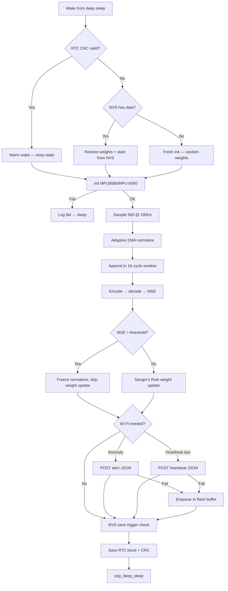

# DeepMonitor

ML-enabled vibration anomaly detection for food-grade industrial machinery.
Single firmware tree that builds for three targets: a development M5StickC Plus2
(with onboard MPU6886 or external MPU-6050) and the production ESP32-WROOM-32E
PCB described in the OPERATING_PLAN.

> **Status:** pre-POC. Tomorrow (2026-05-17) is the first round of household-object
> characterization captures before the Russet House field deployment.

---

## Table of contents

1. [What this is](#1-what-this-is)
2. [Repository layout](#2-repository-layout)
3. [Hardware targets](#3-hardware-targets)
4. [Quick start — tomorrow's tests](#4-quick-start--tomorrows-tests)
5. [Developer setup](#5-developer-setup)
6. [Building and flashing](#6-building-and-flashing)
7. [Configuration and secrets](#7-configuration-and-secrets)
8. [Running host-side tests](#8-running-host-side-tests)
9. [Python tools](#9-python-tools)
10. [Firmware architecture](#10-firmware-architecture)
11. [Adapting to production hardware](#11-adapting-to-production-hardware)
12. [Going to Supabase](#12-going-to-supabase)
13. [Troubleshooting](#13-troubleshooting)
14. [Roadmap pointers](#14-roadmap-pointers)

---

## 1. What this is

A small battery-powered device samples vibration and temperature from an IMU,
normalizes the data adaptively, runs a Sanger's-Rule autoencoder on-device, and
reports anomaly scores plus periodic heartbeats over Wi-Fi to a webhook
(local Flask receiver today, Supabase later).

Key constraints:

- Static memory only (no heap during the duty cycle)
- Deep sleep between cycles; RTC memory + CRC-16 for warm-wake state
- NVS flash snapshots for long-term recovery
- Event-driven Wi-Fi (anomaly alert or scheduled heartbeat)
- Local flash buffering when Wi-Fi/HTTP fails (production target only)

The same firmware compiles unchanged for three hardware targets. See
[OPERATING_PLAN](OPERATING_PLAN) for the broader product/legal/timeline context.

---

## 2. Repository layout

```
DeepMonitor/
├── platformio.ini                  # Three build envs (m5stickc-6886, m5stickc-6050, esp32-wroom-6050)
├── CMakeLists.txt                  # Host-side test build (GoogleTest + RapidCheck)
├── README.md                       # This file
├── .gitignore                      # Ignores .pio/, secrets.h, tools/out/
│
├── src/                            # Firmware (all C++17, namespace-modular)
│   ├── board.h                     # Per-target capability defines & pin map
│   ├── config.h                    # Tunable constants + WIFI/WEBHOOK macros
│   ├── secrets.h.example           # Copy to secrets.h and edit
│   ├── imu.{h,cpp}                 # MPU6886 (M5) and MPU-6050 (external) backends
│   ├── normalizer.{h,cpp}          # EMA mean/var, freeze on anomaly
│   ├── window.{h,cpp}              # 16-entry circular sliding window
│   ├── ml.{h,cpp}                  # Autoencoder + Sanger's Rule online learning
│   ├── rtc.{h,cpp}                 # RTC memory layout + CRC-16 validate/save
│   ├── nvs.{h,cpp}                 # Preferences.h NVS save/load
│   ├── connectivity.{h,cpp}        # Wi-Fi + HTTPClient + optional Bearer auth
│   ├── power.{h,cpp}               # Battery voltage (M5 / ADC / mock)
│   ├── flash_buffer.{h,cpp}        # W25Q32 ring buffer (production) / RAM shim (M5)
│   └── main.cpp                    # Duty-cycle orchestration (setup() body)
│
├── test/                           # GoogleTest + RapidCheck host-side tests
│   ├── test_sanity.cpp             # GTest/RapidCheck plumbing check
│   ├── test_imu.cpp                # Mock IMU init/sample
│   ├── test_duty_cycle.cpp         # Full duty-cycle orchestration tests
│   ├── test_rtc_restore.cpp        # CRC validation + restore paths
│   ├── test_power.cpp              # Power module host mock
│   ├── test_flash_buffer.cpp       # Enqueue/drain round-trip
│   └── test_prop_*.cpp             # 16 RapidCheck property tests (one per Design property)
│
├── tools/                          # Laptop-side Python utilities (Python 3.10+)
│   ├── requirements.txt            # flask (the only dep)
│   ├── local_ingest.py             # Flask receiver → per-device CSV under tools/out/captures/
│   ├── quick_analysis.py           # Compare CSV captures across objects
│   └── battery_sim.py              # Sweep duty-cycle configs for ≥1-year battery life
│
├── docs/
│   └── tests/
│       └── 2026-05-17-first-field-tests.md   # Tomorrow's step-by-step protocol
│
├── .kiro/specs/predictive-maintenance-sensor/
│   ├── requirements.md             # 10 numbered requirements
│   ├── design.md                   # Module/data/property design
│   └── tasks.md                    # Implementation phases (all checked)
│
└── build/                          # CMake build output (gitignored)
```

---

## 3. Hardware targets

| Build env | Board | IMU | Battery readout | Local buffer |
|-----------|-------|-----|-----------------|--------------|
| `m5stickc-6886` | M5StickC Plus2 | Onboard MPU6886 (`M5.Imu`) | `M5.Power` (AXP192) | RAM (single payload) |
| `m5stickc-6050` | M5StickC Plus2 | External MPU-6050 on Grove I²C (SDA=32, SCL=33) | `M5.Power` | RAM (single payload) |
| `esp32-wroom-6050` | ESP32-WROOM-32E (production PCB) | External MPU-6050 on I²C (SDA=21, SCL=22) | ADC GPIO34, 1:1 divider | W25Q32 SPI flash, up to 64 entries |

Target selection is via PlatformIO env (`pio run -e ...`); the rest of the
firmware reads only the `HAS_LCD`, `HAS_M5_POWER`, `HAS_FLASH_BUFFER`, etc.
flags from [`src/board.h`](src/board.h) and stays target-agnostic.

**Tomorrow's tests use `m5stickc-6886` exclusively.** External-IMU and production
PCB envs are present so the same firmware will run on Wensley's first PCB rev
without code changes.

---

## 4. Quick start — tomorrow's tests

Full protocol lives at [docs/tests/2026-05-17-first-field-tests.md](docs/tests/2026-05-17-first-field-tests.md).
Compressed version:

```powershell
# 1. Configure secrets
copy src\secrets.h.example src\secrets.h
notepad src\secrets.h
#   Set WIFI_SSID, WIFI_PASS to your home network.
#   Set WEBHOOK_URL = "http://<laptop-lan-ip>:8000/ingest"
#   (Find <laptop-lan-ip> with `ipconfig` → IPv4 of the Wi-Fi adapter.)

# 2. Install Python deps
pip install -r tools\requirements.txt

# 3. Start the laptop ingest server (leave running all day)
python tools\local_ingest.py
#   Opens http://0.0.0.0:8000  → POST /ingest, GET /health

# 4. Flash the M5StickC Plus2
pio device list
#   Pick the USB-Enhanced-SERIAL CH9102 port (M5StickC Plus2), not Bluetooth COM3/COM4.
pio run -e m5stickc-6886 -t upload --upload-port COM5

# 5. Disconnect USB. The device runs on its own battery and posts every cycle.
#    Watch ingest terminal for heartbeats / anomalies.
#    Move it from desk → computer → fridge → washing machine (see the test doc).

# 6. End of day — analyze
python tools\quick_analysis.py
```

For battery-life planning of the production PCB:

```powershell
python tools\battery_sim.py --output tools\out\battery_results.csv
```

---

## 5. Developer setup

### Prerequisites

| Tool | Version | Notes |
|------|---------|-------|
| Python | 3.10+ | For `tools/` scripts and as PlatformIO's runtime |
| PlatformIO | latest | VS Code extension (`platformio.platformio-ide`) or pipx install |
| CMake | 3.14+ | For host-side test build |
| C++ compiler | C++17 capable | MSVC, MinGW, GCC, or Clang |
| Git | any | For `FetchContent` to pull GoogleTest + RapidCheck |

### One-time install (Windows / PowerShell)

```powershell
# 1. Python
winget install Python.Python.3.12

# 2. Scoop + pipx (not present on a stock Windows install)
Set-ExecutionPolicy -ExecutionPolicy RemoteSigned -Scope CurrentUser
Invoke-RestMethod -Uri https://get.scoop.sh | Invoke-Expression
scoop install pipx

# 3. PlatformIO CLI (or skip steps 2–3 and use the VS Code extension instead)
pipx install platformio

# 4. CMake + MinGW (or use Visual Studio's bundled cmake.exe)
winget install Kitware.CMake
winget install MartinStorsjo.LLVM-MinGW.UCRT
# Legacy compatibility only (MSVCRT runtime):
# winget install MartinStorsjo.LLVM-MinGW.MSVC
```

### Repo clone

```powershell
git clone <repo-url> DeepMonitor
cd DeepMonitor
copy src\secrets.h.example src\secrets.h
```

---

## 6. Building and flashing

All firmware builds go through PlatformIO. The three environments are defined
in [`platformio.ini`](platformio.ini). M5StickC Plus2 targets use PlatformIO board
ID `m5stick-c` with Plus2-specific overrides (8 MB flash, 240 MHz CPU) in the
shared `[common_m5stickc]` section — not `m5stick-c-plus2`, which is not in the
espressif32 platform.

```powershell
# Tomorrow's build
pio run -e m5stickc-6886

# Flash over USB-C (auto-detects port)
pio run -e m5stickc-6886 -t upload

# Open serial monitor at 115200 (select CH9102 COMx from `pio device list`)
pio device monitor -e m5stickc-6886 --port COM5
```

Swap the env for the other targets:

```powershell
pio run -e m5stickc-6050 -t upload    # M5 + external MPU-6050 on Grove
pio run -e esp32-wroom-6050 -t upload # production PCB
```

Clean a single env: `pio run -e m5stickc-6886 -t clean`.

---

## 7. Configuration and secrets

### Secrets ([`src/secrets.h`](src/secrets.h.example))

`src/secrets.h` is **gitignored** — never commit it. Start from
[`src/secrets.h.example`](src/secrets.h.example):

```cpp
#define WIFI_SSID       "your-wifi-ssid"
#define WIFI_PASS       "your-wifi-password"
#define WEBHOOK_URL     "http://192.168.1.100:8000/ingest"
#define SUPABASE_APIKEY ""              // empty = no auth header (local Flask)
#define DEVICE_ID       "M5-DESK-01"
```

Any macro left undefined falls back to the placeholder in
[`src/config.h`](src/config.h) (which is checked by `#ifndef WIFI_SSID …`).
You can also override via PlatformIO build flags in `platformio.ini`:

```ini
build_flags =
    ${common.build_flags}
    -DBOARD_M5STICKC_6886
    -DWIFI_SSID=\"my-net\"
    -DDEVICE_ID=\"M5-PEELER-01\"
```

### Tunable constants ([`src/config.h`](src/config.h))

| Constant | Default | What it controls |
|----------|---------|------------------|
| `SLEEP_DURATION_US` | 300 000 000 (5 min) | Deep-sleep length between samples |
| `SAMPLE_COUNT` × `SAMPLE_RATE_HZ` | 500 × 100 Hz (5 s) | Per-cycle sampling window |
| `WINDOW_SIZE` | 16 | Sliding window of duty cycles fed to the autoencoder |
| `LATENT_DIM` | 4 | Autoencoder bottleneck (compression 32 → 4) |
| `ANOMALY_THRESHOLD` | 0.03 | Reconstruction-error cutoff |
| `SMOOTHING_ALPHA` | 0.1 | EMA factor for normalizer mean/var |
| `LR_INITIAL` / `LR_DECAY_RATE` / `LR_RESET_STREAK` | 0.01 / 0.001 / 10 | Sanger's-Rule learning rate schedule |
| `NVS_SAVE_INTERVAL` | 288 cycles (~24 h) | Periodic flash snapshot |
| `WEIGHT_SHIFT_THRESHOLD` | 0.5 | Triggers an NVS save on large model drift |
| `HEARTBEAT_INTERVAL` | 144 cycles (~12 h) | Wi-Fi heartbeat cadence |
| `WIFI_TIMEOUT_MS` | 10 000 | Per-attempt Wi-Fi connect timeout |

For live bring-up, you can temporarily use `HEARTBEAT_INTERVAL = 1` and shorter
sleep while testing. Restore production-like values afterward.

---

## 8. Running host-side tests

The firmware is structured so every pure-computation module compiles and is
tested on the laptop. Hardware-touching code is replaced by `#ifdef HOST_TEST`
mocks (Wi-Fi, NVS, IMU, M5 LCD/power).

```powershell
mkdir build
cd build
cmake ..
cmake --build . --config Release
.\host_tests.exe
```

Expected output (last lines):

```
[==========] 45 tests from 24 test suites ran. (~600 ms total)
[  PASSED  ] 45 tests.
```

The suite covers:

- 16 RapidCheck property tests (one per design property in
  [.kiro/specs/predictive-maintenance-sensor/design.md](.kiro/specs/predictive-maintenance-sensor/design.md))
- Duty-cycle orchestration (warm wake / IMU failure / hard boot fresh / hard
  boot from NVS / NVS time trigger / heartbeat trigger)
- RTC CRC round-trip + restore branching
- Power and flash-buffer host mocks

Add `--gtest_filter=DutyCycleTest.*` to run a subset.

---

## 9. Python tools

All under [`tools/`](tools/). Single dependency (`flask`) installed via:

```powershell
pip install -r tools\requirements.txt
```

### `local_ingest.py` — laptop receiver

Tiny Flask app. Run all day during a test session:

```powershell
python tools\local_ingest.py                  # binds 0.0.0.0:8000
python tools\local_ingest.py --port 9000      # custom port
python tools\local_ingest.py --debug          # verbose
```

Endpoints:

- `POST /ingest` — alert or heartbeat JSON (same shape as Supabase will receive)
- `GET /health` — `{"status":"ok"}`

Side effects per request:

- Appends a row to `tools/out/captures/<device_id>.csv`
- Prints a one-line summary on stdout

### `quick_analysis.py` — compare object captures

After a test session, prints a comparison table across all device CSVs:

```powershell
python tools\quick_analysis.py
python tools\quick_analysis.py --dir tools\out\captures
```

Reports per device: row count, anomaly count, mean/std of `mean_vibration`,
mean/std/p95 of `reconstruction_error`, mean battery voltage.

### `battery_sim.py` — battery-life sweep

Evaluates per-cycle current draw for ~1900 production-hardware configurations:

```powershell
python tools\battery_sim.py                                 # console summary
python tools\battery_sim.py --output tools\out\battery_results.csv
python tools\battery_sim.py --single 60 5 1                 # one config: 60 min sleep, 5 s active, 1 wifi/day
python tools\battery_sim.py --profile my_profile.json       # override the current model
```

Output includes:

- Total scenarios and how many pass the ≥365-day target
- Best passing config (lowest average current)
- Reference line for the current firmware defaults (5 min sleep, 12 h heartbeat)
- Top-N table sorted by estimated days

The headline result with default parts: the **current** duty-cycle settings give
~6 months on a 2500 mAh 18650. To clear the 1-year target, sleep needs to
stretch (60 min+) and Wi-Fi cadence drops to ~1/day.

---

## 10. Firmware architecture



### Module responsibilities

| Module | Owns |
|--------|------|
| `imu` | Hardware init, 500-sample @ 100 Hz fill, vibration magnitude |
| `normalizer` | Per-batch EMA stats, normalize, freeze-on-anomaly flag |
| `window` | 16-entry circular buffer of `(mean_vib, mean_temp)` summaries |
| `ml` | Autoencoder forward pass, MSE, Sanger's-Rule weight update, weight-shift metric |
| `rtc` | RTC memory struct + CRC-16, warm/hard wake routing, deep sleep entry |
| `persist` (`nvs.*` files) | Preferences.h save/load, time-based and weight-shift triggers |
| `connectivity` | Wi-Fi associate, HTTP POST with optional `Authorization: Bearer`, retry counter |
| `power` | Battery voltage abstraction (M5 / ADC / mock) |
| `flash_buffer` | W25Q32 ring of failed payloads, drained on next successful Wi-Fi |
| `main` | Orchestrates the duty cycle; no logic of its own |

### Memory budget

Total RTC block is statically sized at ~1.2 KB (out of 8 KB ESP32 RTC slow
memory). A `static_assert` in [`src/rtc.cpp`](src/rtc.cpp) enforces the budget.
No `new`/`malloc`/`String` anywhere in the duty cycle.

---

## 11. Adapting to production hardware

When Wensley's rev 1 board arrives:

1. Bring-up per Appendix B of [OPERATING_PLAN](OPERATING_PLAN):
   power → flash blink → I²C → Wi-Fi → SPI flash → battery → soak test.
2. Confirm pin assignments in [`src/board.h`](src/board.h) match the
   schematic. If different, edit `BOARD_ESP32WROOM_6050` block only.
3. Build and flash: `pio run -e esp32-wroom-6050 -t upload`.
4. Verify in the first heartbeat:
   - `battery_voltage` reads sensibly (3.5–4.2 V)
   - No `imu_fail_logged` flag
   - W25Q32 enqueue works (force a Wi-Fi failure to test — disable Wi-Fi
     temporarily, confirm payload survives reboot, drains on reconnect)
5. Run the bench soak test for 14 days; measure actual current draw and feed
   it back into `tools/battery_sim.py --profile` to validate the model.

---

## 12. Going to Supabase

Today's local Flask receiver accepts the **same JSON shapes** Supabase will.
To switch:

1. Create a Supabase project + a `sensor_readings` table matching the alert
   and heartbeat payloads.
2. Update `src/secrets.h`:
   ```cpp
   #define WEBHOOK_URL     "https://<project>.supabase.co/rest/v1/sensor_readings"
   #define SUPABASE_APIKEY "eyJhbGciOi...<service-role-key>"
   ```
3. Reflash. `connectivity::do_post` will start sending
   `Authorization: Bearer <apikey>` + `apikey: <apikey>` headers because
   `SUPABASE_APIKEY` is no longer empty.

No firmware code changes required.

---

## 13. Troubleshooting

| Symptom | Likely cause | Fix |
|---------|--------------|-----|
| `pio run` fails: board not found | First run downloads ESP32 toolchain | Wait, or run `pio platform install espressif32` |
| Upload fails: "no serial port" | M5StickC needs to be powered on with USB-C | Press the power button; close other terminals on the port |
| `pio device monitor` shows COM3/COM4 with no firmware logs | Monitor attached to Bluetooth virtual port, not the M5 USB bridge | Run `pio device list`, then monitor CH9102 COMx explicitly: `pio device monitor -e m5stickc-6886 --port COMx` |
| `host_tests.exe` build fails on Windows | MinGW/MSVC mismatch | Use `cmake -G "MinGW Makefiles" ..` if PATH has MinGW |
| Ingest server starts but no payloads arrive | Wrong `WEBHOOK_URL` host, or Windows firewall blocks port 8000 | Verify laptop's LAN IPv4; allow inbound on port 8000 |
| Every cycle flagged as anomaly | Stale NVS weights from prior, very different environment | `pio run -e ... -t erase` to wipe NVS, then reflash |
| Heartbeats absent while anomalies appear | Older firmware had heartbeat in a non-anomaly branch | Reflash latest firmware and verify serial line prints `hb=1` each cycle in test mode |
| Heartbeats stop after first one | Wi-Fi associates but POST times out | Check ingest terminal for tracebacks; verify route from device to laptop |
| `imu_fail_logged = 1` on every wake (production) | I²C pull-ups missing, or wrong SDA/SCL on board.h | Confirm pull-ups, verify against schematic |
| Battery voltage reads 0.00 V (production) | ADC divider mis-wired or wrong pin | Compare schematic to `BAT_ADC_PIN` in `board.h` |

For long-form troubleshooting of tomorrow's session specifically, see the
"Troubleshooting" section of
[docs/tests/2026-05-17-first-field-tests.md](docs/tests/2026-05-17-first-field-tests.md).

---

## 14. Roadmap pointers

The product/legal/timeline context lives in the OPERATING_PLAN at the project
root. Short version of what comes after tomorrow:

- **Weeks 1–3:** kickoff + Russet House design-partner agreement (gates everything)
- **Weeks 4–10:** parallel — Athmane deploys M5 rigs at Russet House for real
  vibration data; Wensley designs rev 1 PCB
- **Weeks 11–18:** rev 1 PCB bring-up + on-device ML port + soak test
- **Weeks 19–28:** field POC at Russet House — 30 days continuous, at least
  one operator-confirmed anomaly
- **Weeks 28–32:** POC report, demo video, investor deck

The autoencoder, deep-sleep duty cycle, RTC layout, and connectivity all stay
the same across this entire path; only the hardware target changes.

---

## License

Internal — to be decided at incorporation.

## Maintainers

- Athmane — firmware, ML, cloud, dashboard
- Wensley — PCB, mechanical, sourcing, bring-up

Operating cadence: Saturday weekly sync. See OPERATING_PLAN §3.3.
