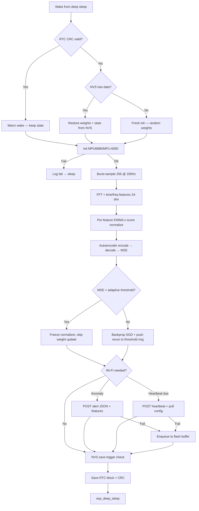

# DeepMonitor

ML-enabled vibration anomaly detection for food-grade industrial machinery,
shipped as a **complete local-first product**:

- **Firmware** — one C++17 tree builds for three ESP32 targets. On-device it
  extracts FFT + statistical vibration features and runs a compact **nonlinear
  autoencoder** (online backprop) with a **self-calibrating adaptive threshold**.
- **Server** ([`server/`](server/)) — FastAPI + SQLite that ingests device
  telemetry, stores it, exposes a REST API, and serves the dashboard.
- **Dashboard** ([`frontend/`](frontend/)) — React + Vite + ECharts UI with fleet
  overview, live charts, FFT spectrograms, anomaly management, device controls
  (a real control plane), reporting/exports, and a raw-data browser.

Run the whole thing on a laptop or Raspberry Pi on the same Wi-Fi as the
sensors. **See [docs/deployment.md](docs/deployment.md) for the runbook.**

> **Status:** deployable v1 (firmware + server + dashboard validated end-to-end).

---

## Table of contents

1. [What this is](#1-what-this-is)
2. [Repository layout](#2-repository-layout)
3. [Hardware targets](#3-hardware-targets)
4. [Quick Start](#4-quick-start)
5. [Developer setup](#5-developer-setup)
6. [Building and flashing](#6-building-and-flashing)
7. [Configuration and secrets](#7-configuration-and-secrets)
8. [Running host-side tests](#8-running-host-side-tests)
9. [Python tools](#9-python-tools)
10. [Firmware architecture](#10-firmware-architecture)
11. [Adapting to production hardware](#11-adapting-to-production-hardware)
12. [Going to Supabase](#12-going-to-supabase)
13. [Troubleshooting](#13-troubleshooting)
14. [Roadmap pointers](#14-roadmap-pointers)
15. [Local server & dashboard](#15-local-server--dashboard)

---

## 1. What this is

A small battery-powered device bursts-samples vibration + temperature from an
IMU, computes a 24-dim feature vector (time-domain stats + an in-house radix-2
FFT band spectrum), z-score normalizes it adaptively, and runs a compact
nonlinear autoencoder on-device. Reconstruction error is compared to an adaptive
threshold (running mean + k·σ of recent normal errors) so each install
self-calibrates. The device reports anomaly alerts + periodic heartbeats over
Wi-Fi to the DeepMonitor server, and **pulls its runtime config** from the same
server each connection (the dashboard control plane).

Key constraints:

- Static memory only (no heap during the duty cycle)
- Deep sleep between cycles; RTC memory + CRC-16 for warm-wake state
- NVS flash snapshots for long-term recovery
- Event-driven Wi-Fi (anomaly alert or scheduled heartbeat) + config pull
- Local flash buffering when Wi-Fi/HTTP fails (production target only)

The same firmware compiles unchanged for three hardware targets. The on-device
model needs no training dataset — it learns the machine's normal signature in
situ. See [docs/project-status.md](docs/project-status.md) for product context
and [docs/deployment.md](docs/deployment.md) for deployment.

---

## 2. Repository layout

```
DeepMonitor/
├── platformio.ini                  # Three build envs (m5stickc-6886, m5stickc-6050, esp32-wroom-6050)
├── CMakeLists.txt                  # Host-side test build (GoogleTest + RapidCheck)
├── Dockerfile / docker-compose.yml # One-command deploy (server + bundled dashboard)
├── README.md                       # This file
│
├── src/                            # Firmware (all C++17, namespace-modular)
│   ├── board.h                     # Per-target capability defines & pin map
│   ├── config.h                    # Tunable constants + runtime DeviceConfig + WIFI/WEBHOOK/CONFIG macros
│   ├── secrets.h.example           # Copy to secrets.h and edit
│   ├── imu.{h,cpp}                 # MPU6886 (M5) and MPU-6050 (external) backends
│   ├── features.{h,cpp}            # In-house radix-2 FFT + 24-dim time/freq feature vector
│   ├── normalizer.{h,cpp}          # Per-feature EWMA z-score, freeze on anomaly
│   ├── ml.{h,cpp}                  # Nonlinear autoencoder (backprop) + adaptive threshold
│   ├── rtc.{h,cpp}                 # RTC memory layout + CRC-16 validate/save
│   ├── nvs.{h,cpp}                 # Preferences.h NVS save/load
│   ├── connectivity.{h,cpp}        # Wi-Fi + HTTPClient + config pull + optional Bearer auth
│   ├── power.{h,cpp}               # Battery voltage (M5 / ADC / mock)
│   ├── flash_buffer.{h,cpp}        # W25Q32 ring buffer (production) / RAM shim (M5)
│   └── main.cpp                    # Duty-cycle orchestration (setup() body)
│
├── test/                           # GoogleTest + RapidCheck host-side tests (54 tests)
│   ├── test_prop_features.cpp      # FFT vs DFT, RMS/crest, constant-signal
│   ├── test_prop_ml.cpp            # AE inference, backprop reduces error, LR schedule, adaptive threshold
│   ├── test_prop_normalizer.cpp    # EWMA formula, z-score, freeze
│   └── test_*.cpp                  # imu / duty-cycle / rtc / nvs / connectivity / power / flash buffer
│
├── server/                         # FastAPI + SQLite backend
│   ├── app/                        # main, db, models, ingest, api, import_csv
│   ├── tests/                      # pytest API suite
│   └── requirements.txt
│
├── frontend/                       # React + Vite + TS + ECharts dashboard
│   └── src/                        # pages: Overview, DeviceDetail, Anomalies, Controls, Reports, DataBrowser
│
├── tools/                          # Laptop-side Python utilities (Python 3.10+)
│   ├── local_ingest.py             # Legacy Flask receiver → CSV (superseded by server/)
│   ├── quick_analysis.py           # Compare CSV captures across objects
│   ├── battery_sim.py              # Battery sweep + --recommend + --curve
│   └── device_sim.py               # Device simulator → POSTs feature payloads to the server
│
├── deploy/deepmonitor.service      # systemd unit (Raspberry Pi, no Docker)
├── docs/deployment.md              # Deployment runbook
└── build/, .pio/, frontend/dist/   # Build outputs (gitignored)
```

---

## 3. Hardware targets

| Build env          | Board                            | IMU                                             | Battery readout         | Local buffer                       |
| ------------------ | -------------------------------- | ----------------------------------------------- | ----------------------- | ---------------------------------- |
| `m5stickc-6886`    | M5StickC Plus2                   | Onboard MPU6886 (`M5.Imu`)                      | `M5.Power` (AXP192)     | RAM (single payload)               |
| `m5stickc-6050`    | M5StickC Plus2                   | External MPU-6050 on Grove I²C (SDA=32, SCL=33) | `M5.Power`              | RAM (single payload)               |
| `esp32-wroom-6050` | ESP32-WROOM-32E (production PCB) | External MPU-6050 on I²C (SDA=21, SCL=22)       | ADC GPIO34, 1:1 divider | W25Q32 SPI flash, up to 64 entries |

Target selection is via PlatformIO env (`pio run -e ...`); the rest of the
firmware reads only the `HAS_LCD`, `HAS_M5_POWER`, `HAS_FLASH_BUFFER`, etc.
flags from [`src/board.h`](src/board.h) and stays target-agnostic.

Initial field-validation runs use `m5stickc-6886` exclusively. External-IMU and
production PCB environments are included so the same firmware can transition to
custom hardware without code-path divergence.

---

## 4. Quick Start

Use this section for fast project bring-up. For complete field execution and
operator workflow, use:

- [docs/tests/2026-05-17-first-field-tests.md](docs/tests/2026-05-17-first-field-tests.md)

```powershell
# 1) Configure runtime secrets
copy src\secrets.h.example src\secrets.h
notepad src\secrets.h
#   Set WIFI_SSID/WIFI_PASS
#   Set WEBHOOK_URL = "http://<laptop-lan-ip>:8000/ingest"

# 2) Start the server + dashboard (see docs/deployment.md for full runbook)
docker compose up -d --build
#   Dashboard + API on http://<laptop-lan-ip>:8000  (ingest at POST /ingest)
#   Or from source: cd server && uvicorn app.main:app  +  cd frontend && npm run build

# 3) Flash firmware
pio device list
#   Use USB-Enhanced-SERIAL CH9102 (M5StickC Plus2), not Bluetooth COM3/COM4.
pio run -e m5stickc-6886 -t upload --upload-port COM5

# 4) Optional serial diagnostics
pio device monitor -e m5stickc-6886 --port COM5

# 5) Or test the whole pipeline without hardware
python tools\device_sim.py --url http://localhost:8000 --device-id M5-SIM1 --cycles 30
```

For battery-life planning:

```powershell
python tools\battery_sim.py --recommend 15 --battery-mah 3000
```

---

## 5. Developer setup

### Prerequisites

| Tool         | Version       | Notes                                                           |
| ------------ | ------------- | --------------------------------------------------------------- |
| Python       | 3.10+         | For `tools/` scripts and as PlatformIO's runtime                |
| PlatformIO   | latest        | VS Code extension (`platformio.platformio-ide`) or pipx install |
| CMake        | 3.14+         | For host-side test build                                        |
| C++ compiler | C++17 capable | MSVC, MinGW, GCC, or Clang                                      |
| Git          | any           | For `FetchContent` to pull GoogleTest + RapidCheck              |

### One-time install (Windows / PowerShell)

```powershell
# 1. Python
winget install Python.Python.3.12

# 2. Scoop + pipx (not present on a stock Windows install)
Set-ExecutionPolicy -ExecutionPolicy RemoteSigned -Scope CurrentUser
Invoke-RestMethod -Uri https://get.scoop.sh | Invoke-Expression
scoop install pipx

# 3. PlatformIO CLI (or skip steps 2–3 and use the VS Code extension instead)
pipx install platformio

# 4. CMake + MinGW (or use Visual Studio's bundled cmake.exe)
winget install Kitware.CMake
winget install MartinStorsjo.LLVM-MinGW.UCRT
# Legacy compatibility only (MSVCRT runtime):
# winget install MartinStorsjo.LLVM-MinGW.MSVC
```

### Repo clone

```powershell
git clone <repo-url> DeepMonitor
cd DeepMonitor
copy src\secrets.h.example src\secrets.h
```

---

## 6. Building and flashing

All firmware builds go through PlatformIO. The three environments are defined
in [`platformio.ini`](platformio.ini). M5StickC Plus2 targets use PlatformIO board
ID `m5stick-c` with Plus2-specific overrides (8 MB flash, 240 MHz CPU) in the
shared `[common_m5stickc]` section — not `m5stick-c-plus2`, which is not in the
espressif32 platform.

```powershell
# Tomorrow's build
pio run -e m5stickc-6886

# Flash over USB-C (auto-detects port)
pio run -e m5stickc-6886 -t upload

# Open serial monitor at 115200 (select CH9102 COMx from `pio device list`)
pio device monitor -e m5stickc-6886 --port COM5
```

Swap the env for the other targets:

```powershell
pio run -e m5stickc-6050 -t upload    # M5 + external MPU-6050 on Grove
pio run -e esp32-wroom-6050 -t upload # production PCB
```

Clean a single env: `pio run -e m5stickc-6886 -t clean`.

---

## 7. Configuration and secrets

### Secrets ([`src/secrets.h`](src/secrets.h.example))

`src/secrets.h` is **gitignored** — never commit it. Start from
[`src/secrets.h.example`](src/secrets.h.example):

```cpp
#define WIFI_SSID       "your-wifi-ssid"
#define WIFI_PASS       "your-wifi-password"
#define WEBHOOK_URL     "http://192.168.1.100:8000/ingest"
#define SUPABASE_APIKEY ""              // empty = no auth header (local Flask)
#define DEVICE_ID       "M5-DESK-01"
```

Any macro left undefined falls back to the placeholder in
[`src/config.h`](src/config.h) (which is checked by `#ifndef WIFI_SSID …`).
You can also override via PlatformIO build flags in `platformio.ini`:

```ini
build_flags =
    ${common.build_flags}
    -DBOARD_M5STICKC_6886
    -DWIFI_SSID=\"my-net\"
    -DDEVICE_ID=\"M5-PEELER-01\"
```

### Tunable constants ([`src/config.h`](src/config.h))

| Constant                                           | Default              | What it controls                                          |
| -------------------------------------------------- | -------------------- | --------------------------------------------------------- |
| `SLEEP_DURATION_US`                                | 900 000 000 (15 min) | Deep-sleep length between samples (battery-optimal)       |
| `SAMPLE_COUNT` × `SAMPLE_RATE_HZ`                  | 256 × 200 Hz (~1.3 s)| Per-cycle sampling burst (Nyquist 100 Hz)                 |
| `FFT_SIZE` / `FREQ_BANDS`                          | 256 / 14             | Radix-2 FFT length and number of band-energy features     |
| `FEATURE_DIM`                                      | 24                   | Feature vector: 6 time + 14 band + 3 spectral + 1 temp    |
| `AE_HIDDEN_DIM` / `AE_LATENT_DIM`                  | 16 / 6               | Autoencoder hidden + bottleneck width                     |
| `ANOMALY_THRESHOLD` / `ANOMALY_K`                  | 0.10 (floor) / 3.0   | Adaptive threshold = max(floor, mean + k·σ)               |
| `RECON_HISTORY` / `RECON_WARMUP`                   | 32 / 8               | Recon-error ring size / cycles before threshold engages   |
| `SMOOTHING_ALPHA`                                  | 0.05                 | Per-feature EWMA factor                                   |
| `LR_INITIAL` / `LR_DECAY_RATE` / `LR_RESET_STREAK` | 0.01 / 0.001 / 10    | SGD learning-rate schedule                                |
| `NVS_SAVE_INTERVAL`                                | 96 cycles (~24 h)    | Periodic flash snapshot                                   |
| `HEARTBEAT_INTERVAL`                               | 96 cycles (~24 h)    | Wi-Fi heartbeat cadence                                   |
| `WIFI_TIMEOUT_MS`                                  | 10 000               | Per-attempt Wi-Fi connect timeout                         |

`SLEEP_DURATION_US`, `HEARTBEAT_INTERVAL`, `SAMPLE_RATE_HZ`, and `ANOMALY_K` are
also **runtime-tunable** from the dashboard (the device pulls them via
`CONFIG_URL`); the values above are the compile-time defaults.

---

## 8. Running host-side tests

The firmware is structured so every pure-computation module compiles and is
tested on the laptop. Hardware-touching code is replaced by `#ifdef HOST_TEST`
mocks (Wi-Fi, NVS, IMU, M5 LCD/power).

```powershell
mkdir build
cd build
cmake ..
cmake --build . --config Release
.\host_tests.exe
```

Expected output (last lines):

```
[==========] 54 tests from 29 test suites ran. (~1.6 s total)
[  PASSED  ] 54 tests.
```

The suite covers:

- Feature extraction (FFT vs naive DFT, RMS/crest relationship, DC-only signal)
- Autoencoder (inference matches a reference forward pass, backprop reduces
  reconstruction error, LR decay/reset, adaptive-threshold warmup/tracking)
- Per-feature normalizer (EWMA formula, z-score, freeze-for-one-cycle)
- Duty-cycle orchestration, RTC CRC round-trip + restore, NVS round-trip,
  connectivity payloads + config-JSON parsing, power and flash-buffer mocks

Add `--gtest_filter=DutyCycleTest.*` to run a subset.

---

## 9. Python tools

All under [`tools/`](tools/). Single dependency (`flask`) installed via:

```powershell
pip install -r tools\requirements.txt
```

### `local_ingest.py` — laptop receiver

Tiny Flask app. Run all day during a test session:

```powershell
python tools\local_ingest.py                  # binds 0.0.0.0:8000
python tools\local_ingest.py --port 9000      # custom port
python tools\local_ingest.py --debug          # verbose
```

Endpoints:

- `POST /ingest` — alert or heartbeat JSON (same shape as Supabase will receive)
- `GET /health` — `{"status":"ok"}`

Side effects per request:

- Appends a row to `tools/out/captures/<device_id>.csv`
- Prints a one-line summary on stdout

### `quick_analysis.py` — compare object captures

After a test session, prints a comparison table across all device CSVs:

```powershell
python tools\quick_analysis.py
python tools\quick_analysis.py --dir tools\out\captures
```

Reports per device: row count, anomaly count, mean/std of `mean_vibration`,
mean/std/p95 of `reconstruction_error`, mean battery voltage.

### `battery_sim.py` — battery-life sweep & recommendation

Models per-cycle current draw for the new ~1.3 s active window:

```powershell
python tools\battery_sim.py                                  # console summary table
python tools\battery_sim.py --recommend 15 --battery-mah 3000  # best config ≤15 min latency
python tools\battery_sim.py --curve tools\out\battery_curve.json  # trade-off curve (dashboard uses this)
python tools\battery_sim.py --single 15 1.3 1                # one config: 15 min sleep, 1.3 s active, 1 wifi/day
```

Headline: the shipped battery-optimal default (15-min sleep, ~1.3 s active,
24 h heartbeat) gives **~3.8 years on a 3000 mAh 18650**. The dashboard
**Controls** tab shows the same curve and an estimated life per sleep interval.

### `device_sim.py` — device simulator

POSTs realistic 24-dim feature payloads (with occasional anomalies) to the
server and exercises the control plane — useful for end-to-end testing without
hardware:

```powershell
python tools\device_sim.py --url http://localhost:8000 --device-id M5-SIM1 --cycles 30
```

---

## 10. Firmware architecture



### Module responsibilities

| Module                    | Owns                                                                            |
| ------------------------- | ------------------------------------------------------------------------------- |
| `imu`                     | Hardware init, 256-sample @ 200 Hz burst, vibration magnitude                   |
| `features`                | In-house radix-2 FFT, time/freq feature vector (24-dim)                          |
| `normalizer`              | Per-feature EWMA mean/var, z-score, freeze-on-anomaly flag                       |
| `ml`                      | Nonlinear autoencoder forward/backprop, adaptive threshold, weight-shift metric |
| `rtc`                     | RTC memory struct + CRC-16, warm/hard wake routing, deep sleep entry            |
| `persist` (`nvs.*` files) | Preferences.h save/load, time-based and weight-shift triggers                   |
| `connectivity`            | Wi-Fi associate, HTTP POST + config GET, optional `Authorization: Bearer`       |
| `power`                   | Battery voltage abstraction (M5 / ADC / mock)                                   |
| `flash_buffer`            | W25Q32 ring of failed payloads, drained on next successful Wi-Fi                |
| `main`                    | Orchestrates the duty cycle; no logic of its own                                |

### Memory budget

The RTC block (weights ~4 KB + feature stats + recon ring + runtime config) is
statically sized at ~4.6 KB, under the 8 KB ESP32 RTC slow-memory budget. A
`static_assert` in [`src/rtc.cpp`](src/rtc.cpp) enforces it. No
`new`/`malloc`/`String` anywhere in the duty cycle.

---

## 11. Adapting to production hardware

When the rev 1 production board is available:

1. Bring-up sequence:
   power → flash blink → I²C → Wi-Fi → SPI flash → battery → soak test.
2. Confirm pin assignments in [`src/board.h`](src/board.h) match the
   schematic. If different, edit `BOARD_ESP32WROOM_6050` block only.
3. Build and flash: `pio run -e esp32-wroom-6050 -t upload`.
4. Verify in the first heartbeat:
   - `battery_voltage` reads sensibly (3.5–4.2 V)
   - No `imu_fail_logged` flag
   - W25Q32 enqueue works (force a Wi-Fi failure to test — disable Wi-Fi
     temporarily, confirm payload survives reboot, drains on reconnect)
5. Run the bench soak test for 14 days; measure actual current draw and feed
   it back into `tools/battery_sim.py --profile` to validate the model.

---

## 12. Going to Supabase

Today's local Flask receiver accepts the **same JSON shapes** Supabase will.
To switch:

1. Create a Supabase project + a `sensor_readings` table matching the alert
   and heartbeat payloads.
2. Update `src/secrets.h`:
   ```cpp
   #define WEBHOOK_URL     "https://<project>.supabase.co/rest/v1/sensor_readings"
   #define SUPABASE_APIKEY "eyJhbGciOi...<service-role-key>"
   ```
3. Reflash. `connectivity::do_post` will start sending
   `Authorization: Bearer <apikey>` + `apikey: <apikey>` headers because
   `SUPABASE_APIKEY` is no longer empty.

No firmware code changes required.

---

## 13. Troubleshooting

| Symptom                                                    | Likely cause                                                      | Fix                                                                                                           |
| ---------------------------------------------------------- | ----------------------------------------------------------------- | ------------------------------------------------------------------------------------------------------------- |
| `pio run` fails: board not found                           | First run downloads ESP32 toolchain                               | Wait, or run `pio platform install espressif32`                                                               |
| Upload fails: "no serial port"                             | M5StickC needs to be powered on with USB-C                        | Press the power button; close other terminals on the port                                                     |
| `pio device monitor` shows COM3/COM4 with no firmware logs | Monitor attached to Bluetooth virtual port, not the M5 USB bridge | Run `pio device list`, then monitor CH9102 COMx explicitly: `pio device monitor -e m5stickc-6886 --port COMx` |
| `host_tests.exe` build fails on Windows                    | MinGW/MSVC mismatch                                               | Use `cmake -G "MinGW Makefiles" ..` if PATH has MinGW                                                         |
| Ingest server starts but no payloads arrive                | Wrong `WEBHOOK_URL` host, or Windows firewall blocks port 8000    | Verify laptop's LAN IPv4; allow inbound on port 8000                                                          |
| Every cycle flagged as anomaly                             | Stale NVS weights from prior, very different environment          | `pio run -e ... -t erase` to wipe NVS, then reflash                                                           |
| Heartbeats absent while anomalies appear                   | Older firmware had heartbeat in a non-anomaly branch              | Reflash latest firmware and verify serial line prints `hb=1` each cycle in test mode                          |
| Heartbeats stop after first one                            | Wi-Fi associates but POST times out                               | Check ingest terminal for tracebacks; verify route from device to laptop                                      |
| `imu_fail_logged = 1` on every wake (production)           | I²C pull-ups missing, or wrong SDA/SCL on board.h                 | Confirm pull-ups, verify against schematic                                                                    |
| Battery voltage reads 0.00 V (production)                  | ADC divider mis-wired or wrong pin                                | Compare schematic to `BAT_ADC_PIN` in `board.h`                                                               |

For long-form troubleshooting of tomorrow's session specifically, see the
"Troubleshooting" section of
[docs/tests/2026-05-17-first-field-tests.md](docs/tests/2026-05-17-first-field-tests.md).

---

## 14. Roadmap pointers

See [docs/project-status.md](docs/project-status.md) for the full status and
post-v1 checklist. Near-term product track:

- Design-partner agreement and field data collection on M5StickC rigs
- Rev 1 production PCB bring-up (`esp32-wroom-6050`) + soak test
- Field POC — 30 days continuous, at least one operator-confirmed anomaly
- POC report, demo video, investor materials

The autoencoder, deep-sleep duty cycle, RTC layout, and connectivity all stay
the same across this path; only the hardware target changes.

---

## 15. Local server & dashboard

The [`server/`](server/) (FastAPI + SQLite) ingests device telemetry and serves
the [`frontend/`](frontend/) React dashboard from the same origin. Full setup,
Docker, and Raspberry Pi instructions are in
[docs/deployment.md](docs/deployment.md).

```powershell
# Docker (recommended) — builds dashboard + serves API on :8000
docker compose up -d --build

# From source (dev)
cd server; python -m venv .venv; .\.venv\Scripts\activate
pip install -r requirements.txt; uvicorn app.main:app --port 8000
cd ..\frontend; npm install; npm run dev        # http://localhost:5173 (proxies API)
```

Dashboard tabs:

- **Overview** — every device with status, battery, recon error, last-seen.
- **Device detail** — recon-error vs adaptive threshold, RMS/temperature,
  battery, latest FFT spectrum, and a band-energy spectrogram over time.
- **Anomalies** — filter, acknowledge, and annotate events by severity.
- **Controls** — push runtime config (sleep, heartbeat, sample rate,
  sensitivity) to a device with pending-vs-applied state + estimated battery
  life and the trade-off curve.
- **Reports** — date-range summaries, CSV export, printable PDF view.
- **Data** — raw readings table with filter/paginate/download.

Key API endpoints (`GET /docs` for the full OpenAPI): `POST /ingest`,
`/api/devices`, `/api/devices/{id}/readings`, `/api/devices/{id}/config`
(GET = device pull, PUT = dashboard push), `/api/anomalies`,
`/api/reports/summary`, `/api/reports/export.csv`, `/api/battery/curve`.

Migrate legacy CSV captures into the database:

```powershell
cd server; python -m app.import_csv ..\tools\out\captures
```

---

## License

License TBD. Source is published for review; rights reserved until a license
is chosen.
