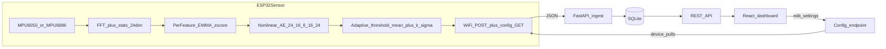
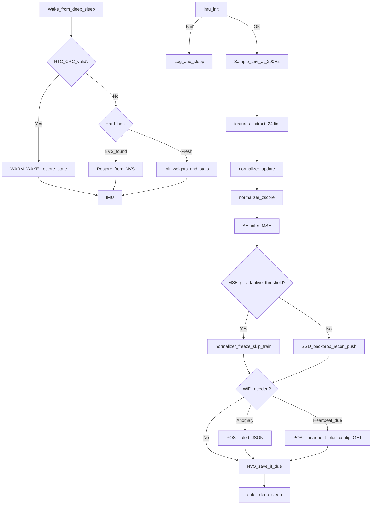

# DeepMonitor — Project Status & Context

**Last updated:** July 2026  
**Status:** Deployable v1 (firmware + server + dashboard validated end-to-end)  
**Plan reference:** Full Deployable DeepMonitor (all 8 workstreams complete)

This document is a thorough snapshot of what DeepMonitor is, what was built, how it
works, what has been validated, and what remains after v1. For day-to-day developer
setup see [README.md](../README.md). For deployment steps see
[deployment.md](deployment.md).

---

## Table of contents

1. [Executive summary](#1-executive-summary)
2. [Product context — what we are building](#2-product-context--what-we-are-building)
3. [End-to-end architecture](#3-end-to-end-architecture)
4. [Before vs after — the v1 transformation](#4-before-vs-after--the-v1-transformation)
5. [Plan workstream status](#5-plan-workstream-status)
6. [Firmware — detailed inventory](#6-firmware--detailed-inventory)
7. [Server & dashboard — detailed inventory](#7-server--dashboard--detailed-inventory)
8. [Tools & packaging](#8-tools--packaging)
9. [Data contracts](#9-data-contracts)
10. [Validation evidence](#10-validation-evidence)
11. [Repository & git state](#11-repository--git-state)
12. [Remaining tasks](#12-remaining-tasks)
13. [Quick start commands](#13-quick-start-commands)
14. [Key defaults and tunables](#14-key-defaults-and-tunables)
15. [Related documents](#15-related-documents)

---

## 1. Executive summary

DeepMonitor is a **local-first, self-hosted** vibration anomaly detection product
for food-grade industrial machinery. A battery-powered ESP32 sensor attaches to
equipment, burst-samples vibration and temperature from an IMU, runs on-device
machine learning, and reports anomalies and periodic heartbeats over Wi-Fi to a
server running on a laptop or Raspberry Pi on the same network.

**What ships in v1:**

| Layer | Technology | Role |
|-------|------------|------|
| Firmware | C++17 / Arduino / ESP32 | Feature extraction, nonlinear autoencoder, adaptive threshold, deep-sleep duty cycle |
| Server | FastAPI + SQLite (SQLModel) | Ingest telemetry, REST API, device control plane |
| Dashboard | React + Vite + TypeScript + ECharts | Fleet overview, charts, anomaly management, controls, reports, data browser |
| Packaging | Docker, docker-compose, systemd | One-command deploy for 24/7 operation |

**Key outcome:** The project moved from a pre-POC firmware prototype (mean
vibration collapsed into a sliding window + linear autoencoder + CSV ingest) to
a **complete deployable product** with richer on-device ML, a real control plane,
and a full web interface — all validated without requiring cloud services or an
offline training dataset.

---

## 2. Product context — what we are building

### Problem

Industrial food-processing equipment (mixers, conveyors, pumps) can develop
mechanical faults that show up as abnormal vibration long before catastrophic
failure. DeepMonitor targets early detection with:

- **Battery-powered** sensors that can run for years on a single 18650 cell
- **No cloud dependency** — all data stays on-premises
- **No training dataset** — each device learns the normal signature of its
  machine in situ via online unsupervised learning
- **Operator-facing dashboard** — not just raw JSON logs

### Solution approach

1. **Burst-sample** the IMU at 200 Hz for ~1.3 seconds each wake cycle
2. **Extract** a fixed 24-dimensional feature vector (time-domain stats +
   FFT band energies) from the waveform — not just a mean
3. **Normalize** per-feature with an adaptive EWMA z-score
4. **Run** a compact nonlinear autoencoder; high reconstruction error on unseen
   patterns flags anomalies
5. **Self-calibrate** the anomaly threshold from recent normal reconstruction
   errors (mean + k·σ)
6. **Report** over Wi-Fi only when needed (anomaly alert or daily heartbeat)
7. **Pull** runtime configuration from the server on each Wi-Fi session

### User-confirmed design decisions

| Decision | Choice |
|----------|--------|
| Hosting | Local-first self-hosted (laptop or Raspberry Pi) |
| ML strategy | Upgraded on-device adaptive autoencoder with FFT + statistical features |
| Default detection latency | ≈ sleep interval; shipped default 15 minutes |
| Default battery profile | 15-min sleep, ~1.3 s active, 24 h heartbeat → ~3.8 years on 3000 mAh |
| Config delivery | Device pulls on next Wi-Fi connect (heartbeat or anomaly); not pushed |

### Hardware targets

Three PlatformIO environments build from one firmware tree
([`platformio.ini`](../platformio.ini)):

| Environment | Board | IMU | Notes |
|-------------|-------|-----|-------|
| `m5stickc-6886` | M5StickC Plus2 | Onboard MPU6886 | Development / field-test rig |
| `m5stickc-6050` | M5StickC Plus2 | External MPU-6050 on Grove I2C | Alternate dev config |
| `esp32-wroom-6050` | ESP32-WROOM-32E custom PCB | MPU-6050 + W25Q32 + 18650 | Production target |

### Firmware constraints (non-negotiable)

- **Static memory only** during the duty cycle — no `new`, `malloc`, or Arduino
  `String`
- **Deep sleep** between cycles; warm-wake state in RTC slow memory with CRC-16
  validation
- **NVS flash** snapshots for recovery across hard boots
- **Event-driven Wi-Fi** — radio on only for anomaly alerts or scheduled
  heartbeats (not every cycle)
- **Flash buffer** (W25Q32 on production PCB) queues failed HTTP payloads for
  retry on next successful connection

---

## 3. End-to-end architecture



### Per-cycle firmware flow



### Memory budget

The `rtc::RtcBlock` in [`src/rtc.h`](../src/rtc.h) holds all warm-wake state:

| Field | Purpose |
|-------|---------|
| `norm_stats` | Per-feature EWMA mean/variance (24 dims) |
| `ml_weights` | Autoencoder W1–W4 + biases (~4 KB) |
| `recon` | 32-entry ring of normal reconstruction errors |
| `cfg` | Runtime `DeviceConfig` (sleep, heartbeat, sample rate, k) |
| `last_features` | Most recent 24-dim feature vector (for telemetry) |
| Counters | duty cycle, NVS save, heartbeat, Wi-Fi/HTTP fail counts |

Total size is ~4.6 KB, enforced by `static_assert(sizeof(rtc::RtcBlock) <= 8192)`
in [`src/rtc.cpp`](../src/rtc.cpp).

---

## 4. Before vs after — the v1 transformation

The "Full Deployable DeepMonitor" plan replaced the pre-POC architecture across
every layer:

| Area | Before (pre-plan) | After (v1) |
|------|-------------------|------------|
| Signal processing | 500 samples @ 100 Hz collapsed to `mean_vib` / `mean_temp` via `window` module | 256 samples @ 200 Hz → 24-dim feature vector via in-house radix-2 FFT |
| ML model | Linear autoencoder + Sanger's Rule on 16-cycle window (`INPUT_DIM=32`) | Nonlinear MLP autoencoder (24→16→6→16→24, tanh) + SGD backprop on features |
| Anomaly detection | Fixed `ANOMALY_THRESHOLD = 0.03` | Adaptive: `max(floor, mean_recon + k·σ)` over 32-cycle ring with 8-cycle warmup |
| Normalizer | 2-dim EMA (vibration + temperature) | Per-feature EWMA z-score over 24 dimensions |
| Config | Compile-time constants only | Runtime `DeviceConfig` in RTC + dashboard control plane via `CONFIG_URL` |
| Telemetry | Mean vib/temp only in JSON | Full 24-dim feature vector in heartbeat/alert payloads |
| Ingest | Flask `tools/local_ingest.py` → per-device CSV | FastAPI `POST /ingest` → SQLite + full REST API |
| UI | None | React + ECharts dashboard (6 pages) |
| Deploy | Manual Python + serial monitor | Docker, docker-compose, systemd unit, deployment runbook |
| Status | Pre-POC validation | Deployable v1 |

**Removed files:**

- `src/window.h`, `src/window.cpp` — sliding 16-cycle mean window (obsolete)
- `test/test_prop_window.cpp` — property tests for the window module

**New major files:**

- `src/features.{h,cpp}` — FFT + feature extraction
- `server/` — entire FastAPI backend
- `frontend/` — entire React dashboard
- `tools/device_sim.py` — end-to-end simulator
- `Dockerfile`, `docker-compose.yml`, `deploy/deepmonitor.service`
- `docs/deployment.md`

---

## 5. Plan workstream status

All eight workstreams from the Full Deployable DeepMonitor plan are **complete**.

| Plan todo | Status | Key artifacts |
|-----------|--------|---------------|
| `features` | **Done** | [`src/features.{h,cpp}`](../src/features.cpp), [`test/test_prop_features.cpp`](../test/test_prop_features.cpp) |
| `autoencoder` | **Done** | [`src/ml.{h,cpp}`](../src/ml.cpp), updated [`src/rtc.h`](../src/rtc.h), [`test/test_prop_ml.cpp`](../test/test_prop_ml.cpp) |
| `control-plane` | **Done** | [`src/connectivity.{h,cpp}`](../src/connectivity.cpp) config GET + expanded JSON; [`src/secrets.h.example`](../src/secrets.h.example) `CONFIG_URL` |
| `battery` | **Done** | [`tools/battery_sim.py`](../tools/battery_sim.py) `--recommend` / `--curve`; defaults in [`src/config.h`](../src/config.h) |
| `backend` | **Done** | [`server/app/`](../server/app/) — main, db, models, ingest, api, import_csv, pytest |
| `frontend` | **Done** | [`frontend/src/pages/`](../frontend/src/pages/) — 6 dashboard pages |
| `packaging` | **Done** | Dockerfile, docker-compose, systemd unit, deployment runbook |
| `e2e` | **Done** | `device_sim.py`; README updated; host tests + pytest + 3 PlatformIO builds validated |

---

## 6. Firmware — detailed inventory

### Configuration ([`src/config.h`](../src/config.h))

| Constant | Value | Meaning |
|----------|-------|---------|
| `SAMPLE_COUNT` | 256 | Samples per burst |
| `SAMPLE_RATE_HZ` | 200 | Hz; ~1.28 s active window, Nyquist 100 Hz |
| `FFT_SIZE` | 256 | Power-of-two FFT length |
| `FREQ_BANDS` | 14 | Spectral band-energy features |
| `FEATURE_DIM` | 24 | Total feature vector size |
| `AE_HIDDEN_DIM` | 16 | Autoencoder hidden layer width |
| `AE_LATENT_DIM` | 6 | Bottleneck / latent dimension |
| `RECON_HISTORY` | 32 | Ring buffer for adaptive threshold |
| `RECON_WARMUP` | 8 | Cycles before adaptive threshold engages |
| `ANOMALY_K` | 3.0 | Sensitivity (σ above mean recon error) |
| `ANOMALY_THRESHOLD` | 0.10 | Floor / bootstrap threshold |
| `SLEEP_DURATION_US` | 900 000 000 | 15 minutes between cycles |
| `HEARTBEAT_INTERVAL` | 96 cycles | ~24 h at 15-min sleep |
| `NVS_SAVE_INTERVAL` | 96 cycles | ~24 h NVS snapshot |
| `SMOOTHING_ALPHA` | 0.05 | Per-feature EWMA factor |
| `LR_INITIAL` | 0.01 | SGD learning rate |
| `LR_DECAY_RATE` | 0.001 | LR decay per normal cycle |
| `LR_RESET_STREAK` | 10 | Normal cycles to reset LR after anomaly streak |

Runtime-overridable via `DeviceConfig` (pulled from server):

- `sleep_duration_us`
- `heartbeat_interval`
- `sample_rate_hz`
- `anomaly_k`
- `config_version`

### Feature vector layout ([`src/features.h`](../src/features.h))

24 dimensions, computed from one burst of 256 vibration + temperature samples:

| Index | Feature | Description |
|-------|---------|-------------|
| 0 | `rms` | RMS of AC (mean-removed) vibration |
| 1 | `peak` | max \|AC\| |
| 2 | `crest_factor` | peak / rms |
| 3 | `kurtosis` | 4th standardized moment (impulsiveness) |
| 4 | `std` | Standard deviation |
| 5 | `peak_to_peak` | max(AC) − min(AC) |
| 6–19 | `band_energy[0..13]` | Log-compressed energy per FFT frequency band |
| 20 | `spectral_centroid` | Normalized energy-weighted mean frequency |
| 21 | `dominant_freq` | Normalized bin of peak magnitude |
| 22 | `total_energy` | Log-compressed total spectral energy |
| 23 | `temp_mean` | Mean temperature over the window |

Implementation: in-house radix-2 Cooley-Tukey FFT in [`src/features.cpp`](../src/features.cpp).
Same code compiles under `HOST_TEST` for property-based verification (FFT vs naive
DFT, Parseval, RMS/crest relationships).

### Autoencoder ([`src/ml.{h,cpp}`](../src/ml.h))

Architecture:

```
input(24) ──W1,b1──▶ tanh ──W2,b2──▶ latent(6) ──W3,b3──▶ tanh ──W4,b4──▶ output(24)
```

- **Inference:** forward pass → MSE reconstruction error vs adaptive threshold
- **Training:** SGD backprop on normal cycles only; anomalous cycles skip weight
  update and call `normalizer::freeze()` for one cycle
- **LR schedule:** decays on normal cycles; resets after `LR_RESET_STREAK`
  consecutive normal cycles following anomalies
- **Adaptive threshold:** `ReconTracker` ring of 32 recent normal recon errors;
  threshold = `max(ANOMALY_THRESHOLD, mean + k·std)` after 8-cycle warmup
- **Init:** Xavier-style uniform random weights; `esp_random()` on device,
  deterministic seed on host

### Normalizer ([`src/normalizer.{h,cpp}`](../src/normalizer.h))

- Per-feature EWMA mean and variance over 24 dimensions
- Z-score normalization with small epsilon noise floor
- `freeze(stats)` — skip one update cycle after anomaly (prevents baseline drift
  from fault signatures)

### Connectivity & control plane ([`src/connectivity.{h,cpp}`](../src/connectivity.h))

**Payload structs:**

- `AlertPayload` — anomaly POST: device_id, timestamp, recon error, threshold,
  mean vib/temp, battery, optional 24-dim features
- `HeartbeatPayload` — periodic POST: uptime, battery, threshold, recon error,
  is_anomaly flag, weight magnitude, Wi-Fi/HTTP diagnostics, applied config
  fields, optional 24-dim features

**Control plane:**

- `fetch_config(config_url, cfg)` — HTTP GET during Wi-Fi session
- `parse_config_json()` — applies newer `config_version` to `DeviceConfig`
- Config changes take effect on the device's **next** Wi-Fi connect

**Secrets** ([`src/secrets.h.example`](../src/secrets.h.example)):

```c
#define WIFI_SSID     "your-wifi-ssid"
#define WIFI_PASS     "your-wifi-password"
#define WEBHOOK_URL   "http://192.168.1.100:8000/ingest"
#define CONFIG_URL    "http://192.168.1.100:8000/api/devices/M5-DESK-01/config"
#define DEVICE_ID     "M5-DESK-01"
```

### Duty cycle orchestration ([`src/main.cpp`](../src/main.cpp))

`run_duty_cycle(rtc::RtcBlock&)` is the single entry point (called from
`setup()` on device, directly from host tests). Static buffers on stack/data
segment for samples and features — no heap.

### Host-side tests ([`test/`](../test/))

54 tests across 29 suites (GoogleTest + RapidCheck), built via
[`CMakeLists.txt`](../CMakeLists.txt) with `HOST_TEST` define:

| Test file | Coverage |
|-----------|----------|
| `test_prop_features.cpp` | FFT vs DFT, Parseval, RMS/crest, constant signal |
| `test_prop_ml.cpp` | AE inference, backprop reduces error, LR schedule, adaptive threshold |
| `test_prop_normalizer.cpp` | EWMA formula, z-score, freeze |
| `test_prop_connectivity.cpp` | Payload build, JSON parse, config fetch mock |
| `test_prop_rtc.cpp` | CRC round-trip, offsetof-based length |
| `test_prop_nvs.cpp` | NVS blob save/load, weight shift |
| `test_duty_cycle.cpp` | Full orchestration paths |
| `test_rtc_restore.cpp` | Warm/hard boot branching |
| `test_imu.cpp` | Mock IMU sample count |
| `test_power.cpp`, `test_flash_buffer.cpp` | Module mocks |
| `test_sanity.cpp` | GTest/RapidCheck plumbing |

---

## 7. Server & dashboard — detailed inventory

### Backend ([`server/`](../server/))

**Stack:** Python 3.12, FastAPI, Uvicorn, SQLModel, SQLite

**Database:** `server/data/deepmonitor.db` (Docker volume `deepmonitor-data`)

**Tables** ([`server/app/models.py`](../server/app/models.py)):

| Table | Purpose |
|-------|---------|
| `Device` | One row per sensor; latest telemetry summary + desired/applied config |
| `Reading` | Every heartbeat and anomaly payload (features stored as JSON) |
| `Anomaly` | Denormalized anomaly events with severity, ack status, notes |

**Ingest** ([`server/app/ingest.py`](../server/app/ingest.py)):

- `POST /ingest` and `POST /api/ingest` — backwards-compatible with firmware JSON
- Accepts legacy field names (`cycle_reconstruction_error`, etc.)
- Upserts `Device`, inserts `Reading`, creates `Anomaly` row on anomaly type
- Updates `applied_config_version` when device reports config fields

**REST API** ([`server/app/api.py`](../server/app/api.py)):

| Method | Endpoint | Purpose |
|--------|----------|---------|
| GET | `/health` | Liveness check |
| GET | `/api/devices` | Fleet list with status (online/offline/anomaly) |
| GET | `/api/devices/{id}` | Device detail |
| GET | `/api/devices/{id}/readings` | Time-series with range + downsample |
| GET | `/api/devices/{id}/config` | Device config pull (control plane) |
| PUT | `/api/devices/{id}/config` | Dashboard config push (bumps `config_version`) |
| GET | `/api/anomalies` | Filterable anomaly list |
| POST | `/api/anomalies/{id}/ack` | Acknowledge with optional note |
| GET | `/api/reports/summary` | Date-range aggregate stats |
| GET | `/api/reports/export.csv` | CSV export |
| GET | `/api/battery/curve` | Sleep-interval vs estimated battery life |
| GET | `/api/battery/estimate` | Single-point estimate for a config |

**Static serving** ([`server/app/main.py`](../server/app/main.py)):

- Serves built React SPA from `frontend/dist/` at `/`
- CORS enabled for dev; single-origin in production Docker build

**CSV migration:**

```bash
cd server && python -m app.import_csv ../tools/out/captures
```

**Tests:** [`server/tests/test_api.py`](../server/tests/test_api.py) — ingest,
devices, config push/pull, reports, battery curve. Isolated DB via
[`server/conftest.py`](../server/conftest.py).

### Frontend ([`frontend/`](../frontend/))

**Stack:** React 18, Vite, TypeScript, ECharts, react-router-dom

**Pages** ([`frontend/src/App.tsx`](../frontend/src/App.tsx)):

| Route | Page | Features |
|-------|------|----------|
| `/` | Overview | Fleet table: status, battery, recon error, last-seen; auto-refresh |
| `/devices/:id` | Device Detail | Recon error vs adaptive threshold chart; RMS + temperature; battery voltage; latest FFT band spectrum; band-energy spectrogram over time; anomaly markers |
| `/anomalies` | Anomalies | Filter by device/ack status; acknowledge with notes; severity badges |
| `/controls` | Controls | Per-device config form (sleep, heartbeat, sample rate, k); pending vs applied state; battery life estimate + trade-off curve |
| `/reports` | Reports | Date-range summary; CSV export; print-friendly PDF view |
| `/data` | Data Browser | Paginated raw readings; filter by device/type; CSV download |

**Shared components:**

- `EChart.tsx` — ECharts wrapper with resize handling
- `ui.tsx` — Card, Stat, StatusBadge, SeverityBadge, Loading, ErrorNote
- `useFetch.ts` — polling hook for live data
- `api.ts` — typed HTTP client
- `format.ts` — number/date formatting, feature labels, sleep duration helpers

**Dev vs production:**

- Dev: `npm run dev` on `:5173` with API proxy to `:8000` ([`vite.config.ts`](../frontend/vite.config.ts))
- Prod: `npm run build` → `frontend/dist/` served by FastAPI / Docker

---

## 8. Tools & packaging

### Python tools ([`tools/`](../tools/))

| Script | Purpose |
|--------|---------|
| `battery_sim.py` | Models per-cycle current draw; `--recommend` picks optimal config for a latency target; `--curve` exports trade-off JSON for dashboard |
| `device_sim.py` | Simulates a device: POSTs realistic 24-dim features, injects anomalies, exercises config pull |
| `local_ingest.py` | **Legacy** Flask receiver → CSV (superseded by `server/`) |
| `quick_analysis.py` | Compare legacy CSV captures |

### Docker ([`Dockerfile`](../Dockerfile))

Multi-stage build:

1. **Stage 1 (node:22-alpine):** `npm install && npm run build` → `frontend/dist`
2. **Stage 2 (python:3.12-slim):** pip install server deps, copy app + built SPA,
   expose `:8000`, run `uvicorn app.main:app`

### Docker Compose ([`docker-compose.yml`](../docker-compose.yml))

- Service `deepmonitor` on port 8000
- Named volume `deepmonitor-data` for SQLite persistence
- `restart: unless-stopped`

### systemd ([`deploy/deepmonitor.service`](../deploy/deepmonitor.service))

Example unit for bare-metal Raspberry Pi deployment without Docker.

### Deployment runbook

Full instructions in [`docs/deployment.md`](deployment.md): Docker, from-source
dev, Pi 24/7, device secrets, CSV import, battery tuning.

---

## 9. Data contracts

### Heartbeat JSON (device → server)

```json
{
  "type": "heartbeat",
  "device_id": "M5-DESK-01",
  "uptime_cycles": 42,
  "battery_voltage": 3.95,
  "anomaly_threshold": 0.12,
  "reconstruction_error": 0.03,
  "is_anomaly": 0,
  "weight_magnitude": 1.2,
  "wifi_fail_count": 0,
  "http_retry_count": 0,
  "config_version": 2,
  "sleep_duration_us": 900000000,
  "heartbeat_interval": 96,
  "sample_rate_hz": 200,
  "features": [0.02, 0.06, 3.0, 3.1, 0.02, 0.12, "... 14 bands ...", 0.25, 0.21, 1.8, 25.3]
}
```

### Anomaly alert JSON

```json
{
  "type": "anomaly",
  "device_id": "M5-DESK-01",
  "timestamp_ms": 123456789,
  "reconstruction_error": 0.45,
  "anomaly_threshold": 0.12,
  "mean_vibration": 0.08,
  "mean_temperature_delta": 0.5,
  "battery_voltage": 3.92,
  "features": ["... 24 floats ..."]
}
```

### Config JSON (server → device, GET `/api/devices/{id}/config`)

```json
{
  "config_version": 3,
  "sleep_duration_us": 900000000,
  "heartbeat_interval": 96,
  "sample_rate_hz": 200,
  "anomaly_k": 3.0
}
```

Device applies only when `config_version` is newer than its stored version.
Dashboard PUT bumps `config_version` on the `Device` row; device echoes
`applied_config_version` in subsequent heartbeats.

---

## 10. Validation evidence

Results from the end-to-end validation session (July 2026):

| Check | Result |
|-------|--------|
| C++ host tests (`cmake` + `ctest`) | **54/54 pass** across 29 suites |
| Backend pytest (`server/tests/`) | **All pass** |
| PlatformIO `m5stickc-6886` | **BUILD SUCCESS** |
| PlatformIO `m5stickc-6050` | **BUILD SUCCESS** |
| PlatformIO `esp32-wroom-6050` | **BUILD SUCCESS** (RAM ~19.1%, Flash ~82.5%) |
| `device_sim.py` → `POST /ingest` | Heartbeats + anomalies ingested; config pull/apply verified |
| Dashboard SPA at `:8000` | All routes serve; API endpoints respond |
| Docker build | Multi-stage image builds frontend + serves API |

**Not yet validated on real hardware in this session:**

- Live M5StickC Plus2 posting to a LAN server
- Production PCB (`esp32-wroom-6050`) with W25Q32 flash buffer
- Field deployment on actual industrial machinery

---

## 11. Repository & git state

v1 is published on GitHub at [Otm02/DeepMonitor](https://github.com/Otm02/DeepMonitor)
(public). The deployable product changeset includes:

- Firmware ML rewrite (`features`, nonlinear AE, adaptive threshold, control plane)
- Removal of the legacy `window` module
- New `server/` (FastAPI + SQLite) and `frontend/` (React dashboard)
- Docker / compose / systemd packaging and deployment docs
- Host tests, backend pytest, and device simulator updates

`src/secrets.h` remains gitignored — only `src/secrets.h.example` ships.

---

## 12. Remaining tasks

### Plan todos: none

All eight workstreams from the Full Deployable DeepMonitor plan are complete.

### Post-v1 operational tasks

These are the natural next steps after v1 code completion:

| Priority | Task | Notes |
|----------|------|-------|
| 1 | **Real hardware bring-up** | Copy `secrets.h.example` → `secrets.h`; set LAN IP for `WEBHOOK_URL` / `CONFIG_URL`; flash M5StickC: `pio run -e m5stickc-6886 -t upload` |
| 2 | **Production server deploy** | `docker compose up -d --build` on laptop or Pi; confirm device reaches `:8000` on LAN |
| 3 | **Field validation** | Mount on real machinery; verify adaptive threshold self-calibrates; operator confirms anomalies match reality. Protocol: [`docs/tests/2026-05-17-first-field-tests.md`](tests/2026-05-17-first-field-tests.md) |
| 4 | **Production PCB track** | Bring up `esp32-wroom-6050` on rev 1 PCB; validate W25Q32 flash buffer drain; soak test |
| 5 | **Design-partner POC** | Field POC — 30 days continuous (README §14 roadmap) |

### Optional hardening (out of v1 scope)

- Server authentication / HTTPS reverse proxy (v1 has no auth — LAN-trusted model)
- Supabase / cloud ingest migration (README §12 documents the path)
- CI pipeline (GitHub Actions: host tests, pytest, PlatformIO matrix build)
- Retire or document-migrate legacy `tools/local_ingest.py` workflow
- Choose an open-source license (currently TBD in README)

### README roadmap timeline (from §14)

Broader product milestones beyond v1 code:

- Weeks 1–3: kickoff + design-partner agreement
- Weeks 4–10: field data collection on M5 rigs + rev 1 PCB design
- Weeks 11–18: rev 1 PCB bring-up + on-device ML port + soak test
- Weeks 19–28: field POC at Russet House — 30 days continuous, ≥1 operator-confirmed anomaly
- Weeks 28–32: POC report, demo video, investor deck

The autoencoder, deep-sleep duty cycle, RTC layout, and connectivity architecture
carry forward across this timeline; only the hardware target changes.

---

## 13. Quick start commands

### Run the full stack (Docker)

```powershell
docker compose up -d --build
# Dashboard + API: http://localhost:8000
```

### Simulate a device (no hardware)

```powershell
python tools\device_sim.py --url http://localhost:8000 --device-id M5-SIM1 --cycles 30
```

### Run from source (development)

```powershell
# Backend
cd server
python -m venv .venv
.\.venv\Scripts\activate
pip install -r requirements.txt
uvicorn app.main:app --reload --port 8000

# Frontend (separate terminal)
cd frontend
npm install
npm run dev
# http://localhost:5173 (proxies API to :8000)
```

### Run tests

```powershell
# C++ host tests
cmake -B build -S . && cmake --build build && ctest --test-dir build

# Backend pytest
cd server && pytest

# Firmware builds (all three targets)
pio run -e m5stickc-6886
pio run -e m5stickc-6050
pio run -e esp32-wroom-6050
```

### Battery planning

```powershell
python tools\battery_sim.py --recommend 15 --battery-mah 3000
python tools\battery_sim.py --curve tools\out\battery_curve.json
```

---

## 14. Key defaults and tunables

| Parameter | Shipped default | Tunable from dashboard | Effect |
|-----------|-----------------|------------------------|--------|
| Sleep interval | 15 min | Yes (`sleep_duration_us`) | Detection latency ≈ sleep interval |
| Heartbeat | ~24 h (96 cycles) | Yes (`heartbeat_interval`) | Wi-Fi cadence for status updates |
| Sample rate | 200 Hz | Yes (`sample_rate_hz`) | Spectral resolution (requires re-flash logic if changed at runtime) |
| Anomaly sensitivity k | 3.0 | Yes (`anomaly_k`) | Threshold = mean + k·σ |
| Anomaly floor | 0.10 | No (compile-time) | Bootstrap threshold before warmup |
| Recon warmup | 8 cycles | No (compile-time) | Cycles before adaptive threshold engages |
| Est. battery life | ~3.8 yr @ 3000 mAh | Via sleep/heartbeat in Controls | See `battery_sim.py` and `/api/battery/curve` |

**Faster detection alternative:** 5-min sleep (also supported by `battery_sim.py
--recommend 5`) at the cost of shorter battery life.

---

## 15. Related documents

| Document | Purpose |
|----------|---------|
| [README.md](../README.md) | Developer guide, architecture diagrams, build/flash instructions, test commands |
| [docs/deployment.md](deployment.md) | Deployment runbook: Docker, from-source, Raspberry Pi, device secrets |
| [docs/tests/2026-05-17-first-field-tests.md](tests/2026-05-17-first-field-tests.md) | Field-test execution protocol |
| Full Deployable DeepMonitor plan | Original implementation plan (`.cursor/plans/` — do not edit) |

---

*This document should be updated when significant milestones are reached (first
hardware field test, git commit of v1, production PCB bring-up, design-partner
POC completion).*
